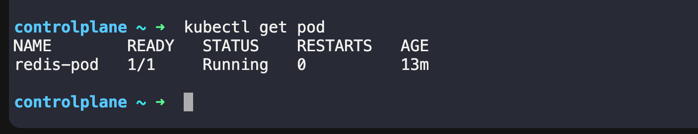

# The Anatomy of a Kubernetes Manifest

Every Kubernetes resource is defined using a YAML manifest with four required top-level fields:

```YAML
apiVersion: v1          # Which API version to use
kind: Pod               # What type of resource
metadata:               # Name, labels, namespace
  name: my-pod
  labels:
    app: my-app
spec:                   # The actual specification (what you want)
  containers:
  - name: my-container
    image: nginx:latest
    ports:
    - containerPort: 80
```

- `apiVersion` — tells Kubernetes which API group to use. For Pods, it is `v1`.
- `kind` — the resource type. Today it is `Pod`. Later you will use `Deployment`, `Service`, etc.
- `metadata` — the identity of your resource. `name` is required. `labels` are key-value pairs used for organization and selection.
- `spec` — the desired state. For a Pod, this means which containers to run, which images, which ports, etc.

---

# Task 1: Create Your First Pod (Nginx)
Create a file called `nginx-pod.yaml:`

```YAML 
apiversion: v1 
kind: pod 
metadata:
  name: nginx-pod 
  labels: 
    app: nginx 
spec: 
  containers: 
  - name: nginx 
    image: nginx:latest 
    ports: 
    - containerPort: 80
```
Apply it: 
```bash 
kubectl apply -f  nginx-pod.yaml
```
verify: 
```bash 
kubectl get pods
kubectl get pods -o wide 
```
OUTPUT: 


Wait until the STATUS shows `Running`. Then explore:
```bash 
# Detailed info about the pod
kubectl describe pod nginx-pod

# Read the logs
kubectl logs nginx-pod

# Get a shell inside the container
kubectl exec -it nginx-pod -- /bin/bash

# Inside the container, run:
curl localhost:80
exit
```
OUTPUT: 


#### Verify: Can you see the Nginx welcome page when you curl from inside the pod?

Yes we are able to see 
OUTPUT: 


# Task 2: Create a Custom Pod (BusyBox)
Write a new manifest `busybox-pod.yaml` from scratch (do not copy-paste the nginx one):
```YAML 
apiVersion: v1
kind: Pod
metadata:
  name: busybox-pod
  labels:
    app: busybox
    environment: dev
spec:
  containers:
  - name: busybox
    image: busybox:latest
    command: ["sh", "-c", "echo Hello from BusyBox && sleep 3600"]
```
Apply and verify:
```bash 
kubectl apply -f busybox-pod.yaml
kubectl get pods
kubectl logs busybox-pod
```
OUTPUT: 


#### Verify: Can you see "Hello from BusyBox" in the logs?
Yes i am able to see "Hello from BusyBox" in the logs 

# Task 3: Imperative vs Declarative

In **Kubernetes**, **Imperative vs Declarative** describes two different ways to manage Kubernetes resources, such as **Pods, Deployments, and Services**.

1. Imperative approach — tell Kubernetes what command to execute
we directly tell Kubernetes the action we want it to perform using a command.

Example: create an Nginx Deployment.
```bash 
kubectl create deployment nginx --image=nginx
```
Other examples:
```bash 
kubectl scale deployment nginx --replicas=3
kubectl delete deployment nginx
```
we issue commands to create, modify, or delete resources.

2. Declarative approach — tell Kubernetes what the desired state should be

we define the desired configuration in a `YAML` file, then apply it. Kubernetes works to make the actual state match that configuration.

Example: `deployment.yaml`
```YAML 
apiVersion: apps/v1
kind: Deployment
metadata:
  name: nginx
spec:
  replicas: 3
  selector:
    matchLabels:
      app: nginx
  template:
    metadata:
      labels:
        app: nginx
    spec:
      containers:
        - name: nginx
          image: nginx
          ports:
            - containerPort: 80
```
Apply the configuration:
```bash
kubectl apply -f deployment.yaml
```
Kubernetes attempts to maintain three replicas. If a Pod fails, the controllers work to restore the desired state.


we have been using the declarative approach (writing YAML, then `kubectl apply`). Kubernetes also supports imperative commands:

```bash 
# Create a pod without a YAML file
kubectl run redis-pod --image=redis:latest

# Check it
kubectl get pods
```
OUTPUT: 


Now extract the YAML that Kubernetes generated: after runnign imperative commnd 
```bash 
kubectl get pod redis-pod -o yaml
```
OUTPUT: 

```YAML 
controlplane ~ ➜  kubectl get pod redis-pod -o yaml
apiVersion: v1
kind: Pod
metadata:
  creationTimestamp: "2026-10-15T06:02:36Z"
  generation: 1
  labels:
    run: redis-pod
  name: redis-pod
  namespace: default
  resourceVersion: "976"
  uid: 97014d7c-6a5d-4516-9040-9cf1674f1335
spec:
  containers:
  - image: redis:latest
    imagePullPolicy: Always
    name: redis-pod
    resources: {}
    terminationMessagePath: /dev/termination-log
    terminationMessagePolicy: File
    volumeMounts:
    - mountPath: /var/run/secrets/kubernetes.io/serviceaccount
      name: kube-api-access-cw2kr
      readOnly: true
  dnsPolicy: ClusterFirst
  enableServiceLinks: true
  nodeName: controlplane
  preemptionPolicy: PreemptLowerPriority
  priority: 0
  restartPolicy: Always
  schedulerName: default-scheduler
  securityContext: {}
  serviceAccount: default
  serviceAccountName: default
  terminationGracePeriodSeconds: 30
  tolerations:
  - effect: NoExecute
    key: node.kubernetes.io/not-ready
    operator: Exists
    tolerationSeconds: 300
  - effect: NoExecute
    key: node.kubernetes.io/unreachable
    operator: Exists
    tolerationSeconds: 300
  volumes:
  - name: kube-api-access-cw2kr
    projected:
      defaultMode: 420
      sources:
      - serviceAccountToken:
          expirationSeconds: 3607
          path: token
      - configMap:
          items:
          - key: ca.crt
            path: ca.crt
          name: kube-root-ca.crt
      - downwardAPI:
          items:
          - fieldRef:
              apiVersion: v1
              fieldPath: metadata.namespace
            path: namespace
status:
  conditions:
  - lastProbeTime: null
    lastTransitionTime: "2026-10-15T06:02:41Z"
    observedGeneration: 1
    status: "True"
    type: PodReadyToStartContainers
  - lastProbeTime: null
    lastTransitionTime: "2026-10-15T06:02:36Z"
    observedGeneration: 1
    status: "True"
    type: Initialized
  - lastProbeTime: null
    lastTransitionTime: "2026-10-15T06:02:41Z"
    observedGeneration: 1
    status: "True"
    type: Ready
  - lastProbeTime: null
    lastTransitionTime: "2026-10-15T06:02:41Z"
    observedGeneration: 1
    status: "True"
    type: ContainersReady
  - lastProbeTime: null
    lastTransitionTime: "2026-10-15T06:02:36Z"
    observedGeneration: 1
    status: "True"
    type: PodScheduled
  containerStatuses:
  - containerID: containerd://37ad6dbe73eac9b2828a2a9a03f22031a3ae65f0ef57bc36a81f457df7150bae
    image: docker.io/library/redis:latest
    imageID: docker.io/library/redis@sha256:2c2dff791878316e3b083188be0d578423b24813cdda5de0e80ea4f7b3e6bfd6
    lastState: {}
    name: redis-pod
    ready: true
    resources: {}
    restartCount: 0
    started: true
    state:
      running:
        startedAt: "2026-10-15T06:02:40Z"
    volumeMounts:
    - mountPath: /var/run/secrets/kubernetes.io/serviceaccount
      name: kube-api-access-cw2kr
      readOnly: true
      recursiveReadOnly: Disabled
  hostIP: 192.168.9.85
  hostIPs:
  - ip: 192.168.9.85
  observedGeneration: 1
  phase: Running
  podIP: 10.22.0.9
  podIPs:
  - ip: 10.22.0.9
  qosClass: BestEffort
  startTime: "2026-10-15T06:02:36Z"

controlplane ~ ➜  
```

#### Compare this output with your hand-written manifests. Notice how much extra metadata Kubernetes adds automatically (status, timestamps, uid, resource version).

- This output shows the difference between a hand-written Kubernetes manifest and the full Pod object returned by the Kubernetes API.

1. What you write vs. what Kubernetes adds

## Kubernetes Pod Manifest: Fields Reference

| Field | Purpose | Added By |
|---|---|---|
| `apiVersion` | Specifies the Kubernetes API version | User |
| `kind` | Specifies the resource type (`Pod`) | User |
| `metadata.name` | Defines the Pod name | User |
| `metadata.labels` | Labels used for identification and selection | User |
| `spec.containers` | Defines container names, images, and configurations | User |
| `metadata.creationTimestamp` | Records when the Pod was created | Kubernetes |
| `metadata.uid` | Unique identifier for the Pod instance | Kubernetes |
| `metadata.resourceVersion` | Tracks the stored object's version | Kubernetes |
| `status.phase` | Indicates the Pod lifecycle phase (e.g., `Running`) | Kubernetes |
| `status.podIP` | Shows the IP address assigned to the Pod | Kubernetes |
| `status.containerStatuses` | Reports container readiness, state, and restart count | Kubernetes |
| `spec.nodeName` | Identifies the node where the Pod is scheduled | Kubernetes Scheduler |

### Important Sections

- **metadata**: Contains the Pod's name, labels, and other identifying information.
- **spec**: Defines the desired state of the Pod, including its containers and images.
- **status**: Reports the actual state of the Pod as observed by Kubernetes.

### Key Takeaways

- Kubernetes automatically generates fields such as `uid`, `resourceVersion`, and `creationTimestamp`.
- Kubernetes updates the `status` section to reflect the Pod's actual state.
- When writing a basic Pod manifest, focus on `apiVersion`, `kind`, `metadata`, and `spec`.
- Avoid manually specifying server-generated metadata and runtime status fields.
- Use `kubectl get pod <pod-name> -o yaml` to inspect the complete Pod object, including fields added by Kubernetes.


#### You can also use dry-run to generate YAML without creating anything:
```bash 
kubectl run test-pod --image=nginx --dry-run=client -o yaml
```
- This is a powerful trick — use it to quickly scaffold a manifest, then customize it.
OUTPUT: 

```YAML 
controlplane ~ ➜  kubectl run test-pod --image=nginx --dry-run=client -o yaml
apiVersion: v1
kind: Pod
metadata:
  labels:
    run: test-pod
  name: test-pod
spec:
  containers:
  - image: nginx
    name: test-pod
    resources: {}
  dnsPolicy: ClusterFirst
  restartPolicy: Always
status: {}

controlplane ~ ➜  

```
#### Verify: Save the dry-run output to a file and compare its structure with your nginx-pod.yaml. What fields are the same? What is different?

Likely differences from your `nginx-pod.yaml` are the **Pod name**, **container name**, and any fields you explicitly added to your `YAML`. The exact differences depend on the contents of your file, 

Also, the generated YAML includes resources: {} and status: {}. These are not necessarily fields you need to include in a minimal hand-written Pod manifest.
