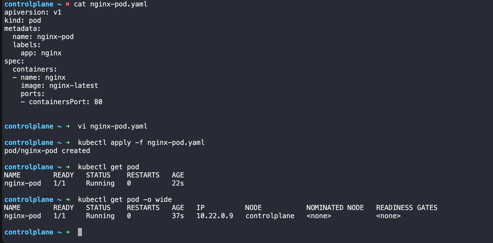
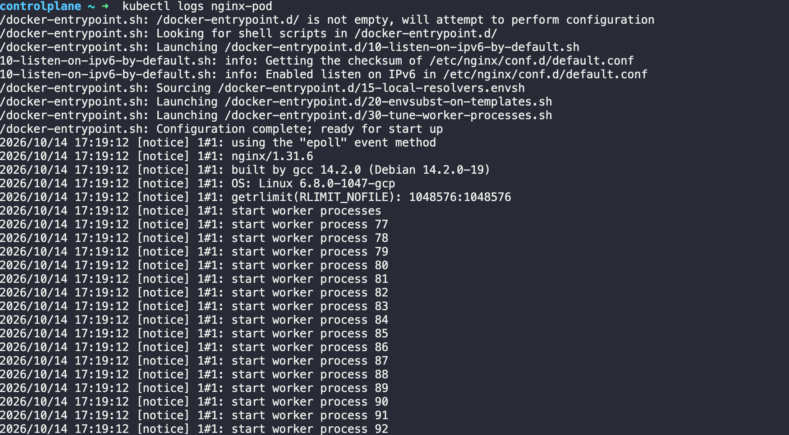
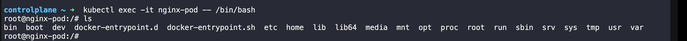
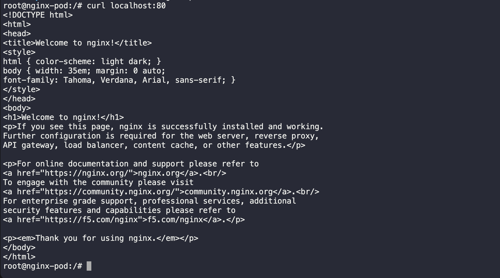
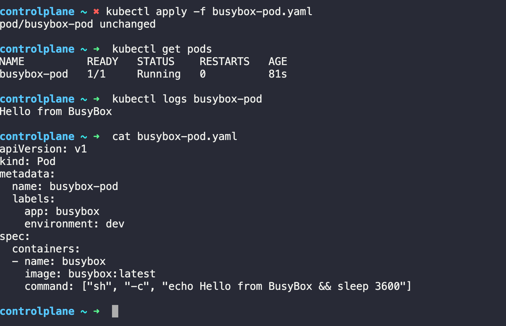

# The Anatomy of a Kubernetes Manifest

Every Kubernetes resource is defined using a YAML manifest with four required top-level fields:

```YAML
apiVersion: v1          # Which API version to use
kind: Pod               # What type of resource
metadata:               # Name, labels, namespace
  name: my-pod
  labels:
    app: my-app
spec:                   # The actual specification (what you want)
  containers:
  - name: my-container
    image: nginx:latest
    ports:
    - containerPort: 80
```

- `apiVersion` — tells Kubernetes which API group to use. For Pods, it is `v1`.
- `kind` — the resource type. Today it is `Pod`. Later you will use `Deployment`, `Service`, etc.
- `metadata` — the identity of your resource. `name` is required. `labels` are key-value pairs used for organization and selection.
- `spec` — the desired state. For a Pod, this means which containers to run, which images, which ports, etc.

---

# Task 1: Create Your First Pod (Nginx)
Create a file called `nginx-pod.yaml:`

```YAML 
apiversion: v1 
kind: pod 
metadata:
  name: nginx-pod 
  labels: 
    app: nginx 
spec: 
  containers: 
  - name: nginx 
    image: nginx:latest 
    ports: 
    - containerPort: 80
```
Apply it: 
```bash 
kubectl apply -f  nginx-pod.yaml
```
verify: 
```bash 
kubectl get pods
kubectl get pods -o wide 
```
OUTPUT: 


Wait until the STATUS shows `Running`. Then explore:
```bash 
# Detailed info about the pod
kubectl describe pod nginx-pod

# Read the logs
kubectl logs nginx-pod

# Get a shell inside the container
kubectl exec -it nginx-pod -- /bin/bash

# Inside the container, run:
curl localhost:80
exit
```
OUTPUT: 



#### Verify: Can you see the Nginx welcome page when you curl from inside the pod?

Yes we are able to see 
OUTPUT: 


# Task 2: Create a Custom Pod (BusyBox)
Write a new manifest `busybox-pod.yaml` from scratch (do not copy-paste the nginx one):
```YAML 
apiVersion: v1
kind: Pod
metadata:
  name: busybox-pod
  labels:
    app: busybox
    environment: dev
spec:
  containers:
  - name: busybox
    image: busybox:latest
    command: ["sh", "-c", "echo Hello from BusyBox && sleep 3600"]
```
Apply and verify:
```bash 
kubectl apply -f busybox-pod.yaml
kubectl get pods
kubectl logs busybox-pod
```
OUTPUT: 


#### Verify: Can you see "Hello from BusyBox" in the logs?
Yes i am able to see "Hello from BusyBox" in the logs 
