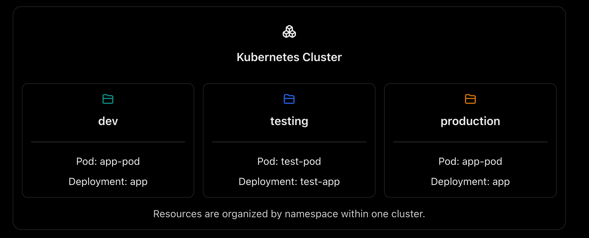
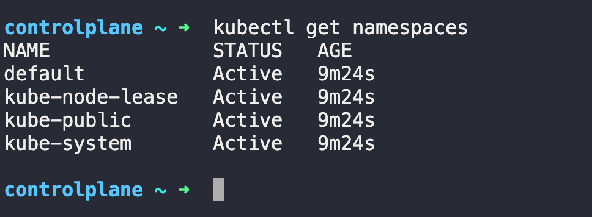
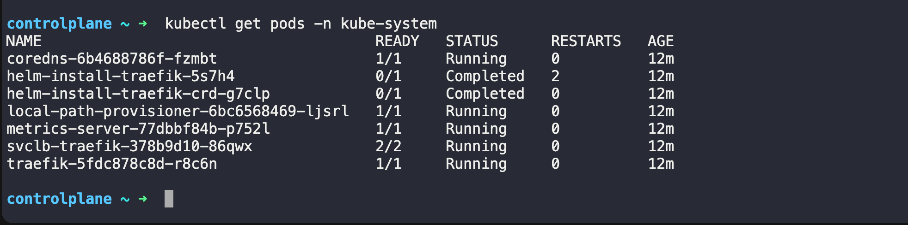
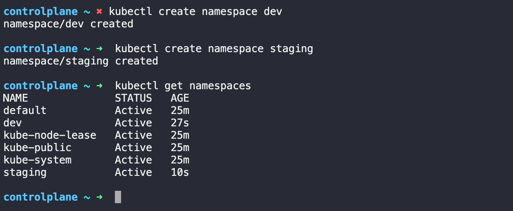
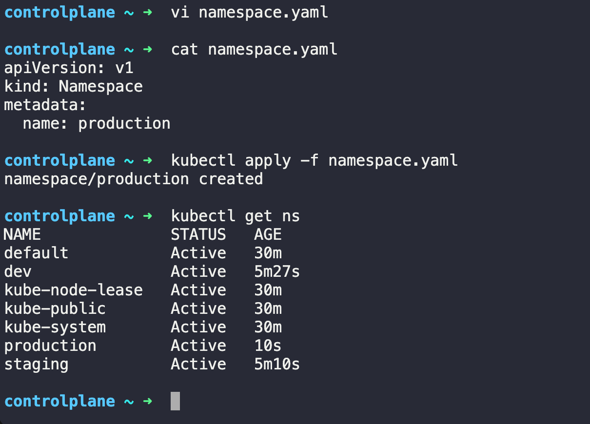
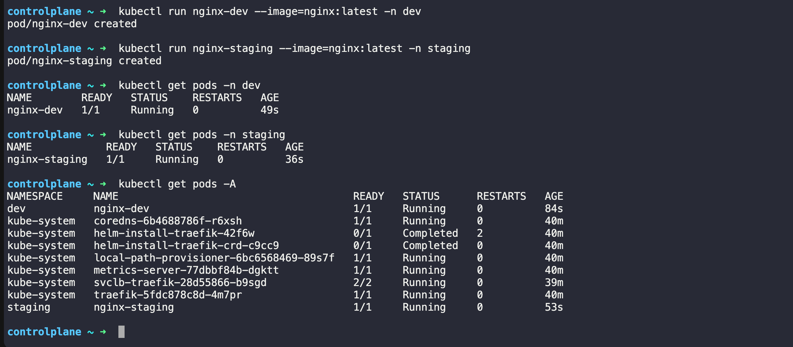

Yesterday in Day-51 we created standalone Pods. The problem? Delete a Pod and it is gone forever — no one recreates it. Today we fix that with Deployments, the real way to run applications in Kubernetes. we will also learn Namespaces, which let you organize and isolate resources inside a cluster.

# Task 1: Explore Default Namespaces

#### Q-> What is Namespaces in Kubernetes?
- A Namespace in Kubernetes is a way to logically divide a single Kubernetes cluster into separate, isolated environments for organizing and managing resources.

- Think of a namespace like a folder on your computer. You use different folders to organize files; Kubernetes uses namespaces to organize resources such as Pods, Deployments, and Services.

- Example of namespaces
 

 - The same resource name can exist in different namespaces. For example, you can have an `app-pod` in both `dev` and `production` namespace.
#### Q-> Why do we use namespaces?
- **Organization**: Separate development, testing, and production resources.
- **Access control**: Use RBAC to control who can access resources in a namespace.
- **Resource management**: Apply resource quotas and limits to namespaces.
- **Name separation**: The same names can be reused across different namespaces for namespaced resources.

- **Important:** Namespaces provide logical separation, not complete security isolation by themselves.

#### IMPT -> Q-> What happens if you run `kubectl get pods` without specifying a namespace?

- Kubernetes lists Pods in the **current namespace**, which is usually `default ` unless your `kubectl context` has been configured differently.

- To see Pods across all namespaces:

```bash
  kubectl get pods -A
``` 


---

# Task 1: Explore Default Namespaces

Kubernetes comes with built-in namespaces. List them:
```bash 
kubectl get namespaces
```
OUTPUT: 


we  should see at least:
- **default** — where your resources go if you do not specify a namespace
- **kube-system** — Kubernetes internal components (API server, scheduler, etc.)
- **kube-public** — publicly readable resources
- **kube-node-lease** — node heartbeat tracking

Check what is running inside `kube-system:`
```bash 
kubectl get pods -n kube-system
```
OUTPUT: 


- These are the control plane components keeping your cluster alive. Do not touch them.

#### Verify: How many pods are running in kube-system?

- There are 5 Pods in the kube-system namespace with status Running. ✅

- Let's count them from our output:
- `coredns` — Running
- `local-path-provisioner` — Running
- `metrics-server` — Running
- `svclb-traefik` — Running (2/2 containers ready)
- `traefik` — Running
- The two `helm-install-traefik` Pods have status Completed, so they aren't counted as running.

# Task 2: Create and Use Custom Namespaces

#### Create two namespaces — one for a `development` environment and one for `staging`:

```bash 
kubectl create namespace dev
kubectl create namespace staging
```
Verify they exist:
```bash 
kubectl get namespaces
```
OUTPUT: 


#### we can also create a namespace from a manifest:
```YAML 
# namespace.yaml
apiVersion: v1
kind: Namespace
metadata:
  name: production
```
Apply the file: 
```bash 
kubectl apply -f namespace.yaml
```
OUTPUT: 


#### Now run a pod in a specific namespace:
```bash 
kubectl run nginx-dev --image=nginx:latest -n dev
kubectl run nginx-staging --image=nginx:latest -n staging
```
List pod accross all the namespace; 
```bash 
kubetl get pods -A 
```
OUTPUT: 


- Notice that `kubectl get pods` without -n only shows the default namespace. You must specify -n <namespace> or use -A to see everything.

#### Verify: Does `kubectl get pods` show these pods? What about `kubectl get pods -A`?
- `kubectl get pods` does not show these Pods because it lists Pods only in the current (`default`) namespace, which has no Pods.
- `kubectl get pods -A` shows Pods across all namespaces, including dev, staging, and kube-system.
