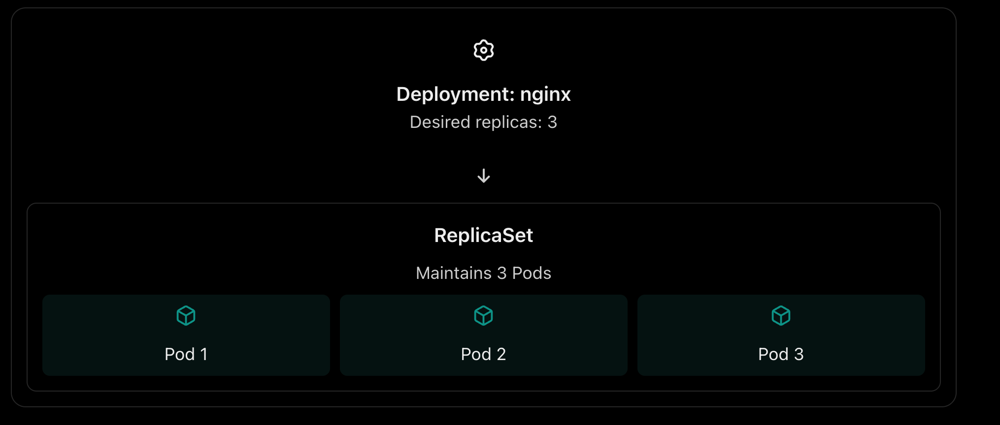
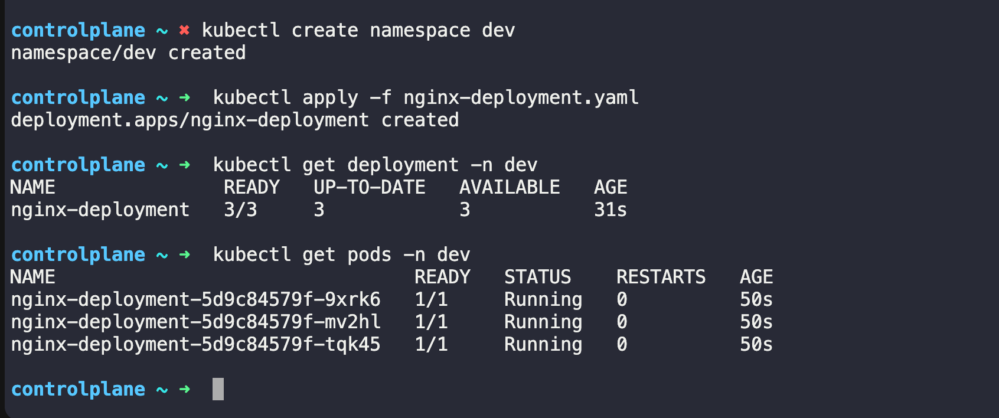
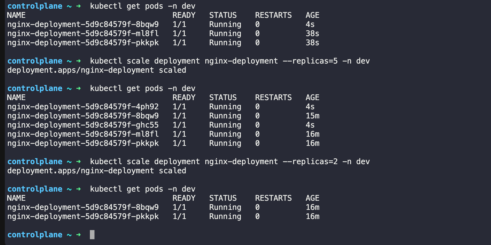
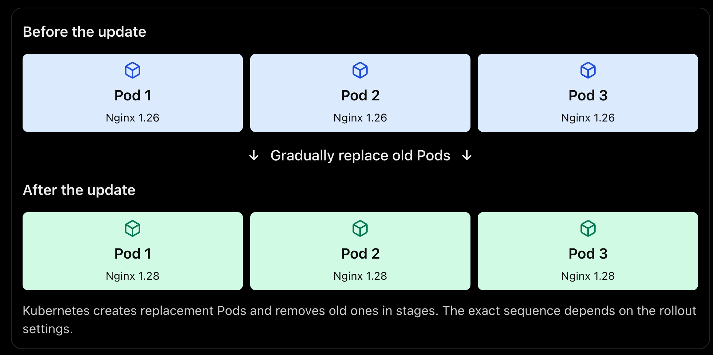
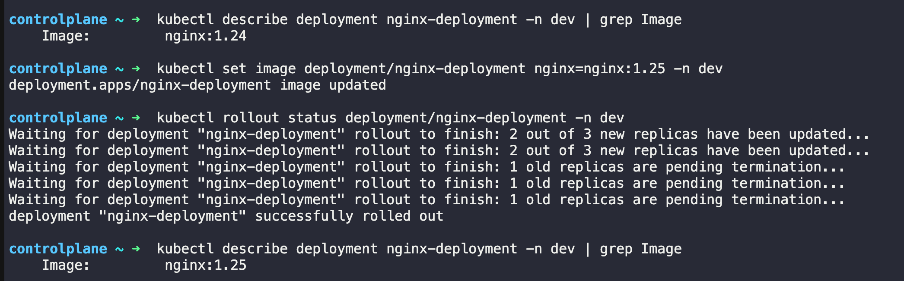
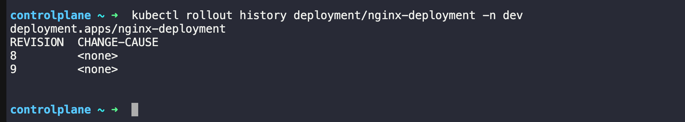

Yesterday in Day-51 we created standalone Pods. The problem? Delete a Pod and it is gone forever — no one recreates it. Today we fix that with Deployments, the real way to run applications in Kubernetes. we will also learn Namespaces, which let you organize and isolate resources inside a cluster.

# Task 1: Explore Default Namespaces

#### Q-> What is Namespaces in Kubernetes?
- A Namespace in Kubernetes is a way to logically divide a single Kubernetes cluster into separate, isolated environments for organizing and managing resources.

- Think of a namespace like a folder on your computer. You use different folders to organize files; Kubernetes uses namespaces to organize resources such as Pods, Deployments, and Services.

- Example of namespaces
 

 - The same resource name can exist in different namespaces. For example, you can have an `app-pod` in both `dev` and `production` namespace.
#### Q-> Why do we use namespaces?
- **Organization**: Separate development, testing, and production resources.
- **Access control**: Use RBAC to control who can access resources in a namespace.
- **Resource management**: Apply resource quotas and limits to namespaces.
- **Name separation**: The same names can be reused across different namespaces for namespaced resources.

- **Important:** Namespaces provide logical separation, not complete security isolation by themselves.

#### IMPT -> Q-> What happens if you run `kubectl get pods` without specifying a namespace?

- Kubernetes lists Pods in the **current namespace**, which is usually `default ` unless your `kubectl context` has been configured differently.

- To see Pods across all namespaces:

```bash
  kubectl get pods -A
``` 


---

# Task 1: Explore Default Namespaces

Kubernetes comes with built-in namespaces. List them:
```bash 
kubectl get namespaces
```
OUTPUT: 


we  should see at least:
- **default** — where your resources go if you do not specify a namespace
- **kube-system** — Kubernetes internal components (API server, scheduler, etc.)
- **kube-public** — publicly readable resources
- **kube-node-lease** — node heartbeat tracking

Check what is running inside `kube-system:`
```bash 
kubectl get pods -n kube-system
```
OUTPUT: 


- These are the control plane components keeping your cluster alive. Do not touch them.

#### Verify: How many pods are running in kube-system?

- There are 5 Pods in the kube-system namespace with status Running. ✅

- Let's count them from our output:
- `coredns` — Running
- `local-path-provisioner` — Running
- `metrics-server` — Running
- `svclb-traefik` — Running (2/2 containers ready)
- `traefik` — Running
- The two `helm-install-traefik` Pods have status Completed, so they aren't counted as running.

# Task 2: Create and Use Custom Namespaces

#### Create two namespaces — one for a `development` environment and one for `staging`:

```bash 
kubectl create namespace dev
kubectl create namespace staging
```
Verify they exist:
```bash 
kubectl get namespaces
```
OUTPUT: 


#### we can also create a namespace from a manifest:
```YAML 
# namespace.yaml
apiVersion: v1
kind: Namespace
metadata:
  name: production
```
Apply the file: 
```bash 
kubectl apply -f namespace.yaml
```
OUTPUT: 


#### Now run a pod in a specific namespace:
```bash 
kubectl run nginx-dev --image=nginx:latest -n dev
kubectl run nginx-staging --image=nginx:latest -n staging
```
List pod accross all the namespace; 
```bash 
kubetl get pods -A 
```
OUTPUT: 


- Notice that `kubectl get pods` without -n only shows the default namespace. You must specify -n <namespace> or use -A to see everything.

#### Verify: Does `kubectl get pods` show these pods? What about `kubectl get pods -A`?
- `kubectl get pods` does not show these Pods because it lists Pods only in the current (`default`) namespace, which has no Pods.
- `kubectl get pods -A` shows Pods across all namespaces, including dev, staging, and kube-system.


---

### Q -> What is Deployment in Kubernetes? 

A **Deployment in Kubernetes (K8s)** is a resource that manages your application's Pods and helps keep the desired number of replicas running. It also lets you update and roll back your application with minimal downtime.

Think of it this way:
- **Pod** = runs your application container.
- **Deployment** = manages how many application replicas should run and how they are updated.
- **ReplicaSet** = created and managed by the Deployment to maintain the desired number of Pods.

#### Example: Why do we need a Deployment?

Suppose you're running an Nginx web application and want 3 copies running for availability.



- If one of these Pods is deleted, the ReplicaSet creates a replacement to restore the desired replica count, assuming the cluster has the capacity and can schedule the Pod.

# Task 3: Create Your First Deployment

A Deployment tells Kubernetes: "I want X replicas of this Pod running at all times." If a Pod crashes, the Deployment controller recreates it automatically.

Create a file `nginx-deployment.yaml:`
```YAML 
apiVersion: apps/v1
kind: Deployment
metadata:
  name: nginx-deployment
  namespace: dev
  labels:
    app: nginx
spec:
  replicas: 3
  selector:
    matchLabels:
      app: nginx
  template:
    metadata:
      labels:
        app: nginx
    spec:
      containers:
      - name: nginx
        image: nginx:1.24
        ports:
        - containerPort: 80
```
Key differences from a standalone Pod:

- `kind: Deployment` instead of `kind: Pod`
- `apiVersion: apps/v1` instead of `v1`
- `replicas: 3` tells Kubernetes to maintain 3 identical pods
- `selector.matchLabels` connects the Deployment to its Pods
- `template` is the Pod template — the Deployment creates Pods using this blueprint

Apply it:
```bash 
kubectl apply -f nginx-deployment.yaml
```
Check the result:
```bash 
kubectl get deployments -n dev
kubectl get pods -n dev
```
OUTPUT:


we can see 3 pods with names like nginx-deployment-xxxxx-yyyyy.

#### Verify: What do the READY, UP-TO-DATE, and AVAILABLE columns mean in the deployment output?

OUTOUT EXAMPLE: 
```
NAME               READY   UP-TO-DATE   AVAILABLE
nginx-deployment   3/3     3            3
```

What does each column mean?

- **READY: 3/3** -> Three Pods are ready out of the three desired replicas. A ready Pod can receive traffic from Services that select it.

- **UP-TO-DATE: 3** -> All three replicas have been updated to match the Deployment's current Pod template.

- **AVAILABLE: 3** -> Three replicas are available to serve the application, meeting Kubernetes' availability criteria.

- **Interview-ready answer**: `READY` tells me how many desired replicas are ready, `UP-TO-DATE ` tells me how many replicas use the latest Pod template, and `AVAILABLE` tells me how many replicas are available to serve the application.

# Task 4: Self-Healing — Delete a Pod and Watch It Come Back

This is the key difference between a Deployment and a standalone Pod.
```bash 
# List pods
kubectl get pods -n dev

# Delete one of the deployment's pods (use an actual pod name from your output)
kubectl delete pod <pod-name> -n dev

# Immediately check again
kubectl get pods -n dev
```
- The Deployment controller detects that only 2 of 3 desired replicas exist and immediately creates a new one. The deleted pod is replaced within seconds.

#### Verify: Is the replacement pod's name the same as the one you deleted, or different?

The replacement Pod's name is different.
- **Deleted Pod:** `ginx-deployment-5d9c84579f-g2dpd`
- **Replacement Pod:** `nginx-deployment-5d9c84579f-8bqw9`

**Why?** The Deployment manages the desired number of replicas through a ReplicaSet. When you deleted the Pod, the ReplicaSet detected that only two Pods remained instead of the desired three and created a replacement with a new, unique name.

**Notice** that the middle part, `5d9c84579f`, remains the same because the replacement belongs to the same ReplicaSet. The final part, `8bqw9`, is different.

**Key takeaway:** Kubernetes replaces the deleted Pod to maintain the desired state, but it does not recreate it with the same name.

# Task 5: Scale the Deployment
Change the number of replicas:
```bash 
# Scale up to 5
kubectl scale deployment nginx-deployment --replicas=5 -n dev
kubectl get pods -n dev

# Scale down to 2
kubectl scale deployment nginx-deployment --replicas=2 -n dev
kubectl get pods -n dev
```
OUTPUT: 


- Watch how Kubernetes creates or terminates pods to match the desired count.


- we  can also scale by editing the manifest — change replicas: 4 in our YAML file and run `kubectl apply -f nginx-deployment.yaml` again.

#### Verify: When you scaled down from 5 to 2, what happened to the extra pods?

When we scaled down the Deployment, the extra Pods were terminated, reducing the number of Pods from 5 to 2.

In our output, only two Pods remained in the Running state:
- `nginx-deployment-5d9c84579f-8bqw9`
- `nginx-deployment-5d9c84579f-pkkpk`

The other Pods were removed by Kubernetes to match the desired replica count of 2.

**Key takeaway:** When we scale down a Deployment, Kubernetes deletes excess Pods to maintain the requested number of replicas. The specific Pods selected for deletion are determined by Kubernetes; you shouldn't assume it always deletes the newest ones.

# Task 6: Rolling Update

Q-> What is Rolling Update in Kubernetes ?

- In Kubernetes, a Rolling Update is a deployment strategy that updates an application gradually by replacing old Pods with new Pods, instead of stopping all the old Pods at once.

- The main goal is to **update an application with minimal downtime.**

1. Example: Rolling Update

Suppose our Deployment has 3 replicas running Nginx version `1.26`, and you want to upgrade to version `1.28`.



2. How does it work?
- You update the Deployment's container image.
- Kubernetes creates new Pods using the updated configuration.
- It waits for new Pods to become ready, according to the rollout strategy and readiness checks.
- It gradually terminates old Pods.
- The process continues until all desired replicas run the new version.

This helps keep the application available during the update, provided enough healthy replicas and capacity are available.


---

Update the Nginx image version to trigger a rolling update:
```bash 
kubectl set image deployment/nginx-deployment nginx=nginx:1.25 -n dev
```
Watch the rollout in real time:
```bash 
kubectl rollout status deployment/nginx-deployment -n dev
```
Verify the new version of IMAGE :
```bash 
kubectl describe deployment nginx-deployment -n dev | grep Image
```

OUTPUT:


- Kubernetes replaces pods one by one — old pods are terminated only after new ones are healthy. This means zero downtime.


Check the rollout history:-> It will show how many times we deploy new version and rolled it back 
```bash 
kubectl rollout history deployment/nginx-deployment -n dev
```
OUTPUT:


Now roll back to the previous version:
```bash 
kubectl rollout undo deployment/nginx-deployment -n dev
kubectl rollout status deployment/nginx-deployment -n dev
```
Verify the image is back to the previous version:
```bash 
kubectl describe deployment nginx-deployment -n dev | grep Image
```

#### Verify: What image version is running after the rollback?

```
controlplane ~ ➜  kubectl describe deployment nginx-deployment -n dev | grep Image
    Image:         nginx:1.24

controlplane ~ ➜  
```
Image Version `nginx:1.24` is runnign after rollback 


