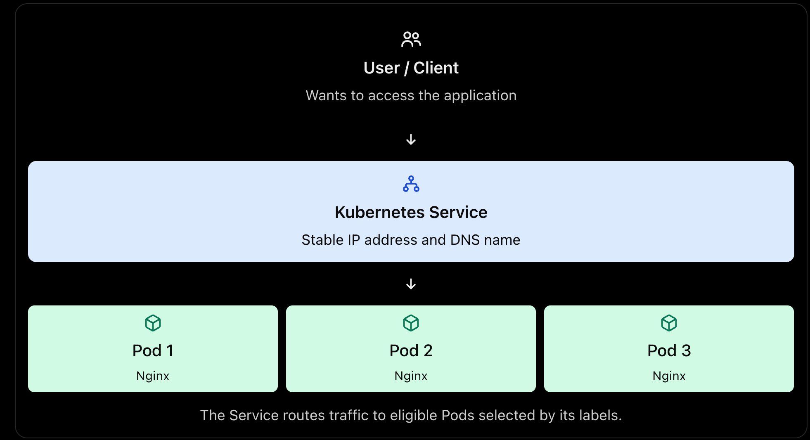
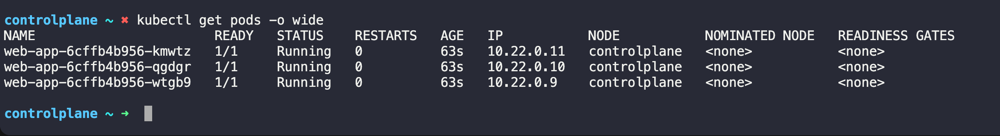

## Task
You have Deployments running multiple Pods, but how do you actually talk to them? Pods get random IP addresses that change every time they restart. Services solve this by giving your Pods a stable network endpoint. Today you will create different types of Services and understand when to use each one.

---

#### Q-> What is services in kubernetes ?

- In Kubernetes (K8s), a Service is an object that provides a stable way to access a group of Pods, even when those Pods are deleted, recreated, or replaced.

Let's understand it step by step.

1. Why do we need a Service?

-  Imagine your Deployment runs three Nginx Pods:



- Pods are temporary. If one Pod is deleted, Kubernetes may create a replacement with a different name and IP address.

- Without a Service, clients would need to keep track of changing Pod IP addresses. A Service provides a stable network endpoint and directs traffic to the appropriate Pods.

Interview-ready answer: A Kubernetes Service provides a stable IP address and DNS name for accessing a set of Pods. It uses label selectors to identify eligible Pods and distributes traffic among them, so clients don't need to track changing Pod IP addresses.

#### Why do we need a Service?

There are two main problems:

1. Pod IPs are not stable: When a Pod is deleted and replaced, the new Pod can get a different IP address.

2. Multiple Pods exist: A Deployment may run three or more replicas. Clients shouldn't need to know each Pod's individual IP address.

A Kubernetes Service solves both problems by providing a stable IP address and DNS name and directing traffic to eligible Pods.

```
                 Client
                    |
                    v
          Service (stable IP/DNS)
                    |
             +------+------+ 
             |      |      |
             v      v      v
           Pod 1  Pod 2  Pod 3
```

One important detail: A Service's IP and DNS name remain stable for the lifetime of that Service. If you delete and recreate the Service, its ClusterIP may change. Also, traffic distribution depends on the Service type and networking implementation; it isn't necessarily perfectly even across Pods.

# Challenge Tasks

# Task 1: Deploy the Application

First, create a Deployment that you will expose with Services. Create `app-deployment.yaml:`

```YAML
apiVersion: apps/v1
kind: Deployment
metadata:
  name: web-app
  labels:
    app: web-app
spec:
  replicas: 3
  selector:
    matchLabels:
      app: web-app
  template:
    metadata:
      labels:
        app: web-app
    spec:
      containers:
      - name: nginx
        image: nginx:1.25
        ports:
        - containerPort: 80
```
Verify :
```bash
kubectl apply -f app-deployment.yaml
kubectl get pods -o wide
```
OUTPUT:


Note the individual Pod IPs. These will change if pods restart — that is the problem Services fix.

### Q-> Verify: Are all 3 pods running? Note down their IP addresses.

Yes, all 3 Pods are running. Each Pod shows `READY 1/1 and STATUS Running`.

```
Pod name	                IP address	Status
web-app-6cffb4b956-kmwtz	10.22.0.11	Running
web-app-6cffb4b956-qgdgr	10.22.0.10	Running
web-app-6cffb4b956-wtgb9	10.22.0.9	Running
```
**Key takeaway:** Each Pod has its own IP address. These IPs can change when Pods are replaced, which is one reason we use a Kubernetes Service to provide a stable endpoint.
