## Task
You have Deployments running multiple Pods, but how do you actually talk to them? Pods get random IP addresses that change every time they restart. Services solve this by giving your Pods a stable network endpoint. Today you will create different types of Services and understand when to use each one.

---

#### Q-> What is services in kubernetes ?

- In Kubernetes (K8s), a Service is an object that provides a stable way to access a group of Pods, even when those Pods are deleted, recreated, or replaced.

Let's understand it step by step.

1. Why do we need a Service?

-  Imagine your Deployment runs three Nginx Pods:


- Pods are temporary. If one Pod is deleted, Kubernetes may create a replacement with a different name and IP address.

- Without a Service, clients would need to keep track of changing Pod IP addresses. A Service provides a stable network endpoint and directs traffic to the appropriate Pods.

Interview-ready answer: A Kubernetes Service provides a stable IP address and DNS name for accessing a set of Pods. It uses label selectors to identify eligible Pods and distributes traffic among them, so clients don't need to track changing Pod IP addresses.

#### Why do we need a Service?

There are two main problems:

1. Pod IPs are not stable: When a Pod is deleted and replaced, the new Pod can get a different IP address.

2. Multiple Pods exist: A Deployment may run three or more replicas. Clients shouldn't need to know each Pod's individual IP address.

A Kubernetes Service solves both problems by providing a stable IP address and DNS name and directing traffic to eligible Pods.

```
                 Client
                    |
                    v
          Service (stable IP/DNS)
                    |
             +------+------+ 
             |      |      |
             v      v      v
           Pod 1  Pod 2  Pod 3
```

One important detail: A Service's IP and DNS name remain stable for the lifetime of that Service. If you delete and recreate the Service, its ClusterIP may change. Also, traffic distribution depends on the Service type and networking implementation; it isn't necessarily perfectly even across Pods.

# Challenge Tasks

# Task 1: Deploy the Application

First, create a Deployment that you will expose with Services. Create `app-deployment.yaml:`

```YAML
apiVersion: apps/v1
kind: Deployment
metadata:
  name: web-app
  labels:
    app: web-app
spec:
  replicas: 3
  selector:
    matchLabels:
      app: web-app
  template:
    metadata:
      labels:
        app: web-app
    spec:
      containers:
      - name: nginx
        image: nginx:1.25
        ports:
        - containerPort: 80
```
Verify :
```bash
kubectl apply -f app-deployment.yaml
kubectl get pods -o wide
```
OUTPUT:


Note the individual Pod IPs. These will change if pods restart — that is the problem Services fix.

### Q-> Verify: Are all 3 pods running? Note down their IP addresses.

Yes, all 3 Pods are running. Each Pod shows `READY 1/1 and STATUS Running`.

```
Pod name	                IP address	Status
web-app-6cffb4b956-kmwtz	10.22.0.11	Running
web-app-6cffb4b956-qgdgr	10.22.0.10	Running
web-app-6cffb4b956-wtgb9	10.22.0.9	Running
```
**Key takeaway:** Each Pod has its own IP address. These IPs can change when Pods are replaced, which is one reason we use a Kubernetes Service to provide a stable endpoint.

# Task 2: ClusterIP Service (Internal Access)

**ClusterIP** -> The default Service type. It exposes an application using an internal cluster IP, making it accessible from within the cluster.

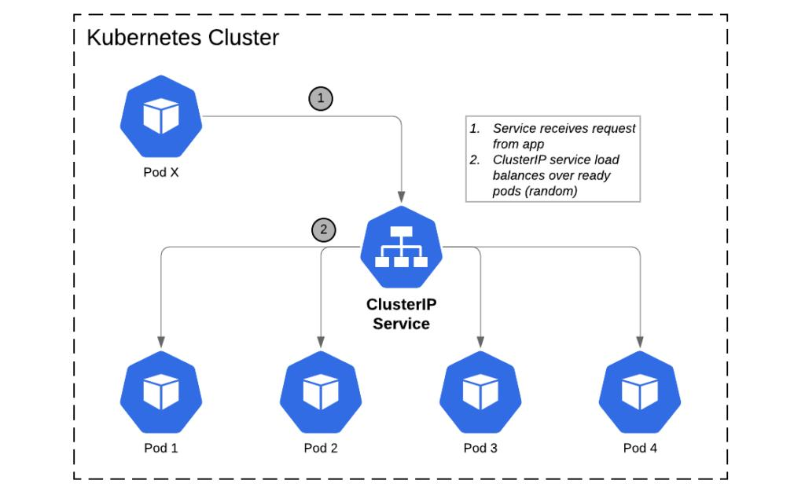

- Example: one application accessing another application inside Kubernetes.

- **ClusterIP** is the default Service type. It gives your Pods a stable internal IP that is only reachable from within the cluster.

Create `clusterip-service.yaml:`

```YAML 
apiVersion: v1
kind: Service
metadata:
  name: web-app-clusterip
spec:
  type: ClusterIP
  selector:
    app: web-app
  ports:
  - port: 80
    targetPort: 80
```
Key fields:
- `selector.app: web-app` — this Service routes traffic to all Pods with the label `app: web-app`
- `port: 80` — the port the Service listens on
- `targetPort: 80` — the port on the Pod to forward traffic to

```bash 
kubectl apply -f clusterip-service.yaml
kubectl get services
```
OUTPUT: 
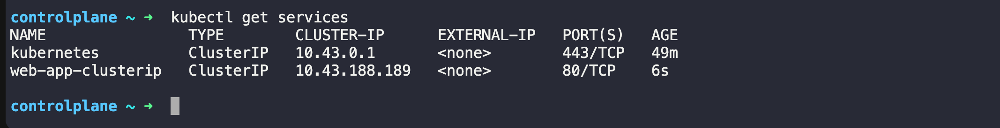

- we can see `web-app-clusterip` with a CLUSTER-IP address. This IP is stable — it will not change even if Pods restart.

Now test it from inside the cluster:
```bash 
# Run a temporary pod to test connectivity
kubectl run test-client --image=busybox:latest --rm -it --restart=Never -- sh

# Inside the test pod, run:
wget -qO- http://web-app-clusterip
exit
```
OUTPUT: 
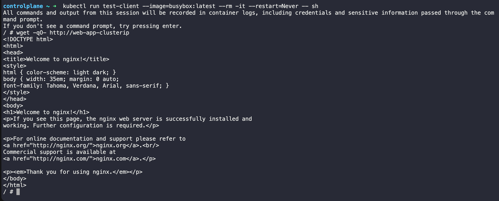

- we can see the Nginx welcome page. The Service load-balanced our request to one of the 3 Pods.

#### Verify: Does the Service respond? Try running the wget command multiple times — the Service distributes traffic across all healthy Pods.


You should receive the Nginx welcome page each time.

**Important:** Repeated successful responses confirm connectivity, but they don't prove that traffic reached different Pods. Since all three Pods serve the same default page, you can't identify which Pod responded just from this output.

**Key takeaway:** A Kubernetes Service provides a stable endpoint for accessing the application without needing to know the individual Pod IP addresses.

# Task 3: Discover Services with DNS

In Kubernetes, **“Discover Services with DNS”** means accessing a Kubernetes Service using its DNS name instead of remembering or typing its IP address.


1. Without DNS vs. with DNS

Imagine your Service is named `web-app-clusterip.`

Without DNS, you would need to know the Service's ClusterIP:
```bash 
wget -qO- http://10.96.100.25
```
The IP above is just an example.

With DNS, you can use its name:
```bash 
wget -qO- http://web-app-clusterip
```
That's what we already did in our previous task lab, and we received the Nginx welcome page!

2. How does it work?

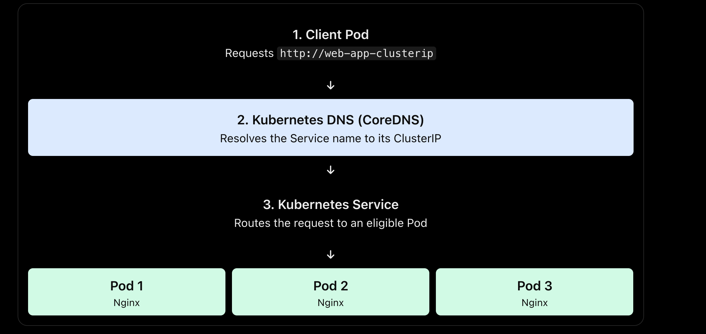

Kubernetes typically uses CoreDNS to resolve Service names. The Service then directs traffic to eligible backend Pods.

3. Service DNS name format

A Service in the same namespace can usually be accessed by its short name:

```
web-app-clusterip
```
The fully qualified DNS name follows this format:

```
<service-name>.<namespace>.svc.cluster.local
```

For example, if the Service is in the `default ` namespace:

```bash 
wget -qO- http://web-app-clusterip.default.svc.cluster.local
```
If the Service is in the `dev` namespace, use:

```bash 
wget -qO- http://web-app-clusterip.dev.svc.cluster.local
```
The short name generally works when the client and Service are in the same namespace.


---

### Step 1: Check the Service

First, in your Kubernetes lab terminal, run:
```bash 
kubectl get services
```
What we're checking: Whether the `web-app-clusterip` Service exists and what its `CLUSTER-IP` is.

OUTPUT: 
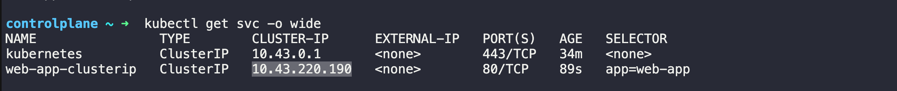

### Step 2: Create a temporary DNS test Pod
Run this command in your terminal:
```bash 
kubectl run dns-test --image=busybox:latest --rm -it --restart=Never -- sh
```
This creates a temporary BusyBox Pod and opens a shell inside it. You should see a prompt similar to:
```
/ #
```
### Step 3: Test the Service's DNS name

Run this command inside the Pod:
```bash 
nslookup web-app-clusterip
```
OUTPUT: 
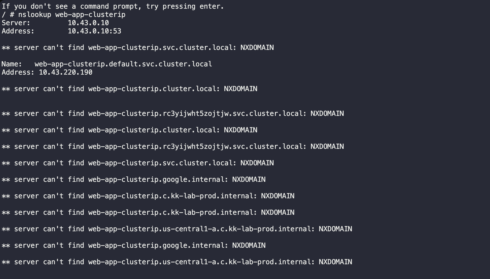

Compare it with the Service IP from Step 1:
```
Check	                         IP address
kubectl get svc — ClusterIP	     10.43.220.190
nslookup — DNS result	        10.43.220.190
Result	                          Match! ✅
```

### Step 4: Test the full DNS name

You're still inside the Pod at / #. Run:
```bash 
wget -qO- http://web-app-clusterip.default.svc.cluster.local
```
- This tests whether you can access the Service using its fully qualified DNS name. You should see the Nginx welcome page.

OUTPUT:
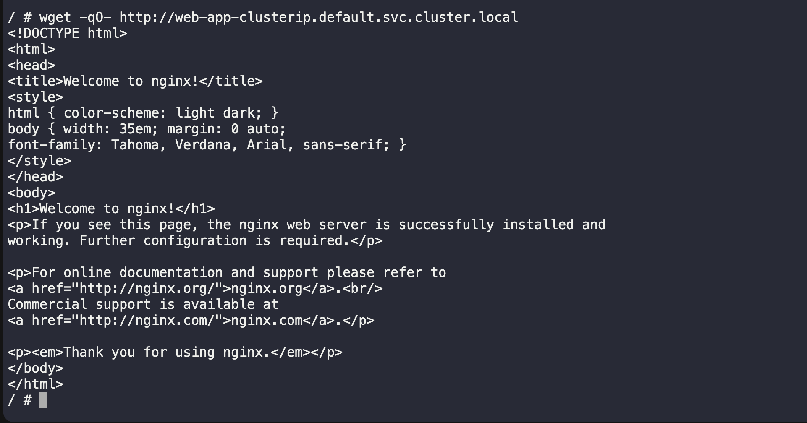

- returned the Nginx Welcome page, confirming that the request reached the application through the Service.

---

# Task 4: NodePort Service (External Access via Node)

A NodePort Service exposes your application on a port on every node in the cluster. This lets you access the Service from outside the cluster.


Exposes a Service on a port across the cluster's nodes, allowing access through a node IP and that port, subject to network access.

Example: accessing a lab application through a node's IP address and NodePort.

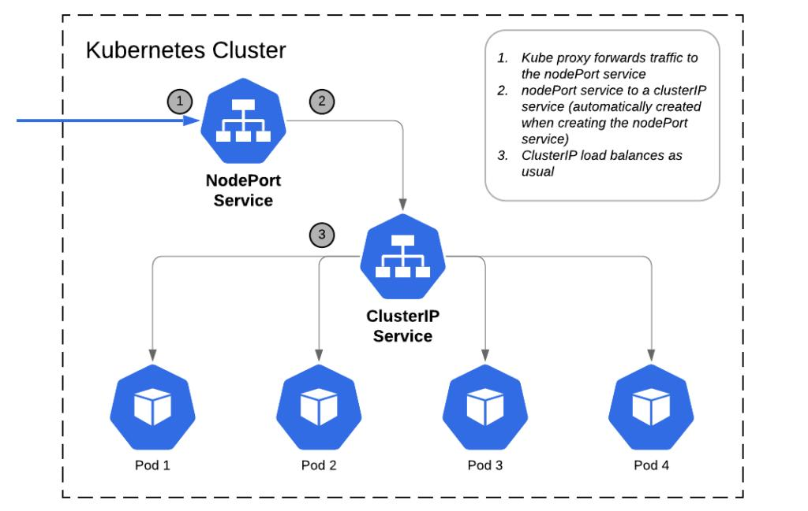


Create `nodeport-service.yaml:`
```YAML 
apiVersion: v1
kind: Service
metadata:
  name: web-app-nodeport
spec:
  type: NodePort
  selector:
    app: web-app
  ports:
  - port: 80
    targetPort: 80
    nodePort: 30080
```
- `nodePort: 30080` — the port opened on every node (must be in range 30000-32767)

- Traffic flow: `<NodeIP>:30080` -> Service -> Pod:80

```bash 
kubectl apply -f nodeport-service.yaml
kubectl get services
```
OUTPUT: 

Access the service: -> # If using Minikube

```bash 
# If using Minikube
minikube service web-app-nodeport --url

# If using Kind, get the node IP first
kubectl get nodes -o wide
# Then curl <node-internal-ip>:30080

# If using Docker Desktop
curl http://localhost:30080
```

#### Verify: Can you see the Nginx welcome page from your browser or terminal using the NodePort?

OUTPUT:
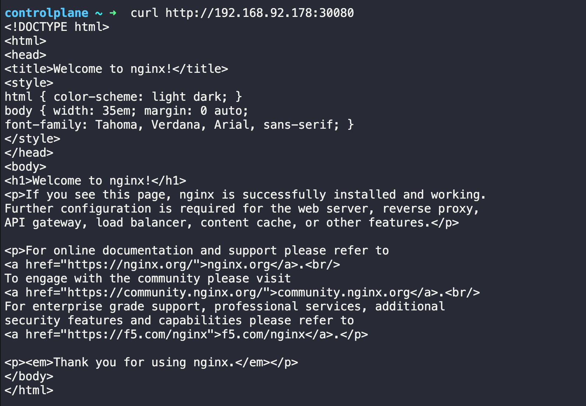

# Task 5: LoadBalancer Service (Cloud External Access)

Exposes a Service externally through a load balancer, typically provisioned by a supported cloud or infrastructure provider.

In a cloud environment (AWS, GCP, Azure), a LoadBalancer Service provisions a real external load balancer that routes traffic to your nodes.


Example: allowing external users to access a web application.
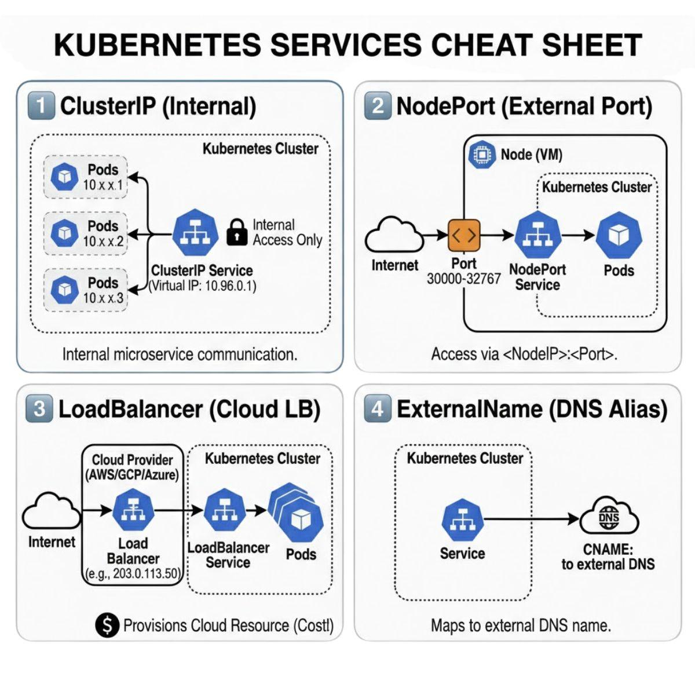

Create `loadbalancer-service.yaml:`
```YAML 
apiVersion: v1
kind: Service
metadata:
  name: web-app-loadbalancer
spec:
  type: LoadBalancer
  selector:
    app: web-app
  ports:
  - port: 80
    targetPort: 80
```
Now Apply: 
```bash 
kubectl apply -f loadbalancer-service.yaml
kubectl get services
```

On a local cluster (Minikube, Kind, Docker Desktop), the EXTERNAL-IP will show <pending> because there is no cloud provider to create a real load balancer. This is expected.

If you are using Minikube:

```bash 
# Minikube can simulate a LoadBalancer
minikube tunnel
# In another terminal, check again:
kubectl get services
```
In a real cloud cluster, the EXTERNAL-IP would be a public IP address or hostname provisioned by the cloud provider.
OUTPUT: 
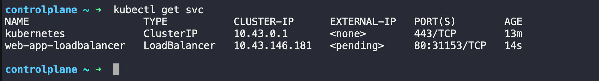

#### Verify: What does the EXTERNAL-IP column show? Why is it `<pending>` on a local cluster?

The EXTERNAL-IP column shows `<pending>` for our `web-app-loadbalancer` Service.

Why is it `<pending>`?

- our Kubernetes cluster is running locally in a lab environment. A LoadBalancer Service asks the underlying infrastructure or cloud provider to provision an external load balancer and assign an external IP address.

- Important:` <pending>` does not necessarily mean the application or Service is broken. It means the external IP has not been assigned.

**Key takeaway:** Cloud clusters often provision a load balancer automatically through their cloud integration. Local clusters generally need a load-balancer implementation or another access method to expose the application externally.

# Task 6: Understand the Service Types Side by Side

Check all three services:
```bash 
kubectl get services -o wide 
```
Compare them:

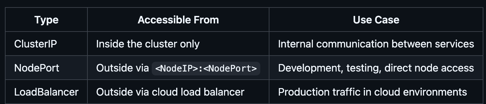

Each type builds on the previous one:

- LoadBalancer creates a NodePort, which creates a ClusterIP
- So a LoadBalancer service also has a ClusterIP and a NodePort

Verify this:
```bash
kubectl describe service web-app-loadbalancer
```
OUTPUT:
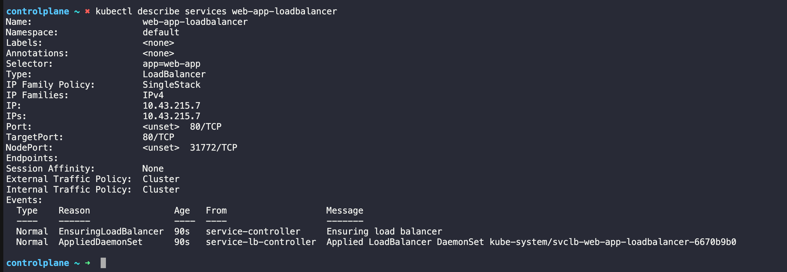

You should see all three: a `ClusterIP`, a `NodePort`, and the `LoadBalancer` configuration.

#### Verify: Does the LoadBalancer service also have a ClusterIP and NodePort assigned?
Yes! Your web-app-loadbalancer Service has both assigned:
- ClusterIP: 10.43.215.7
- NodePort: 31772

Its type is LoadBalancer. The external IP is not shown in this describe output, but the earlier kubectl get svc showed it as `<pending>`.

Note: The Endpoints field is empty, so the Service currently has no eligible backend Pods listed.
