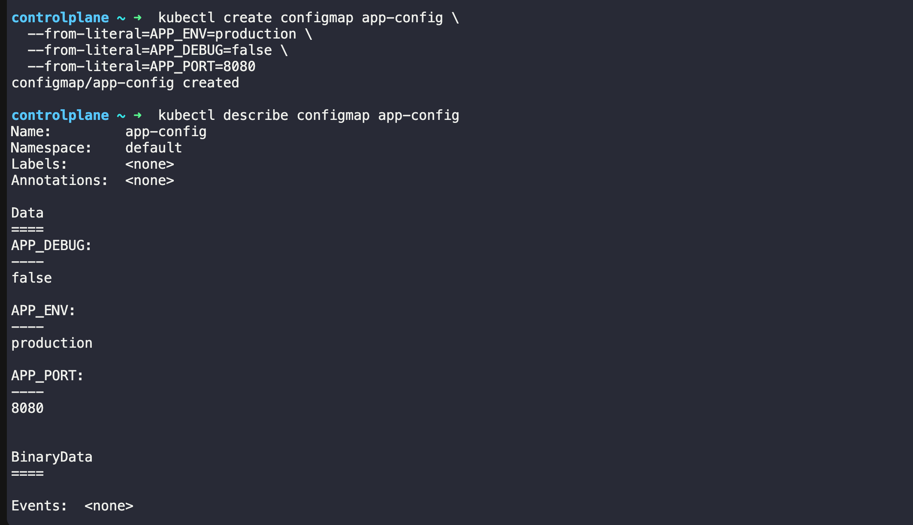
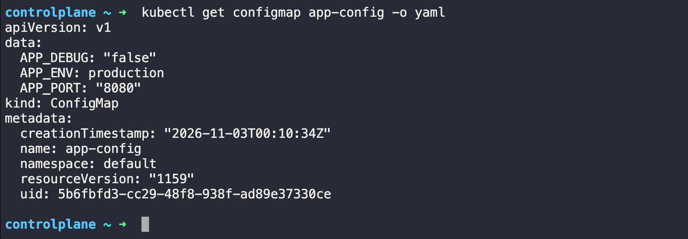
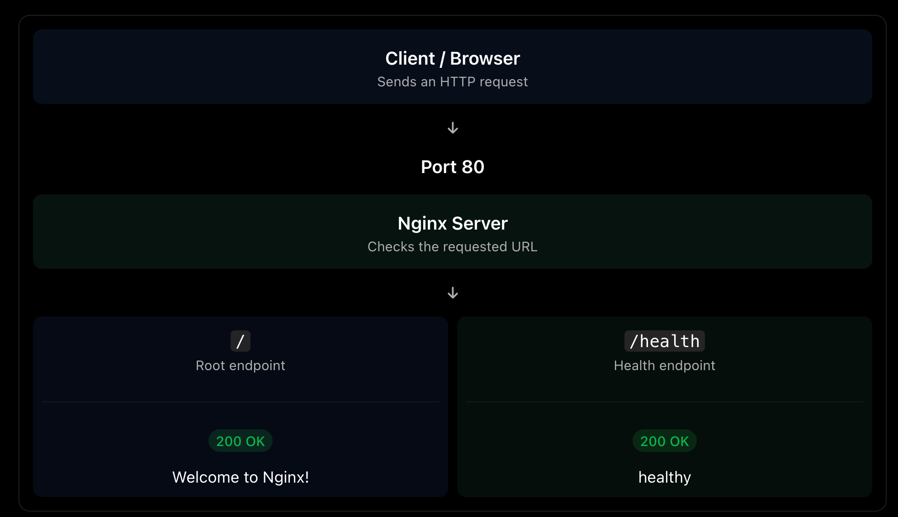
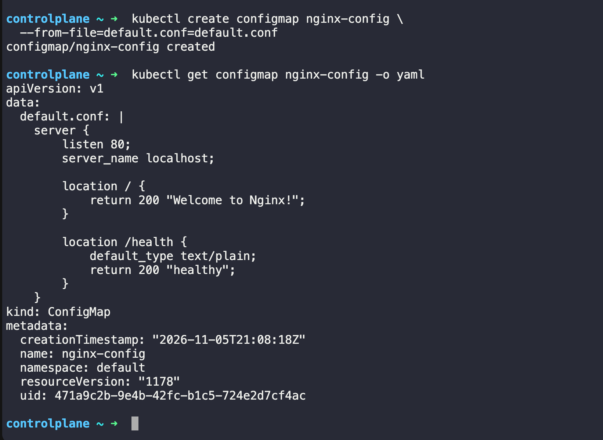
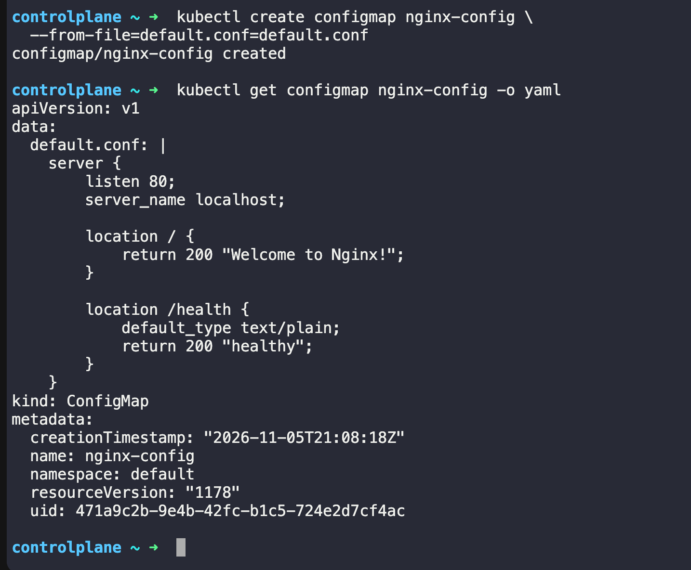

# Kubernetes ConfigMaps and Secrets 

In Kubernetes, ConfigMap and Secret are used to store configuration data separately from your application container image. The main difference is that a ConfigMap stores non-sensitive configuration, while a Secret is intended for sensitive information such as passwords and tokens.

1. What is a ConfigMap?

A ConfigMap stores non-sensitive configuration data as key-value pairs.


For example, suppose your Nginx or web application needs to know which environment it's running in and what application URL to use.

Instead of hardcoding those values into your application image, you can store them in a ConfigMap.

Exmaple: 
```YAML 
apiVersion: v1 
kind: ConfigMap 
metadata: 
  name: app-config
data: 
  APP_ENV: "development"
  LOG_LEVEL: "info"
  APP_COLOR: "blue"
```
Here:
- `APP_ENV ` stores the environment name.
- `LOG_LEVEL ` defines the logging level.
- `APP_COLOR` stores a non-sensitive application setting.

**Why use it?**

-  You can change configuration without rebuilding your application image. Depending on how the application consumes the configuration, you may still need to restart or reload it for changes to take effect.

2. What is a Secret?

A Secret stores sensitive information, such as:

- Database passwords
- API tokens
- Credentials
- TLS certificates and keys

Example:

```YAML 
apiVersion: v1 
kind: Secret 
metadata: 
  name: app-secret
type: Opaque
stringData:
  DB_USERNAME: "appuser"
  DB_PASSWORD: "example-password"
```

**Important security detail:** Kubernetes Secrets are not automatically encrypted just because they're called Secrets. Their values are commonly `Base64-encoded` in the data field, which is not encryption. For production, use encryption at rest, restrictive RBAC permissions, and avoid committing real credentials to Git.


# Challenge Tasks

# Task 1: Create a ConfigMap from Literals

### Step 1: Create the ConfigMap

Run this command in our Kubernetes lab terminal:
```bash 
kubectl create configmap app-config \
  --from-literal=APP_ENV=production \
  --from-literal=APP_DEBUG=false \
  --from-literal=APP_PORT=8080

```

- This creates a ConfigMap named `app-config` with three `key-value` pairs.

### Step 2: Inspect the ConfigMap

First, run:
```bash 
kubectl describe configmap app-config
```

Then run:
```bash 
kubectl get configmap app-config -o yaml
```
OUTPUT: 


---



# Task 2: Create a ConfigMap from a File

### Step 1: Create the Nginx configuration file

Create a file named `default.conf:`

```bash 
cat <<EOF > default.conf
server {
    listen 80;
    server_name localhost;

    location / {
        return 200 "Welcome to Nginx!";
    }

    location /health {
        default_type text/plain;
        return 200 "healthy";
    }
}
EOF
```

#### Understanding the Nginx configuration

Server block
```bash 
server {
    listen 80;
    server_name localhost;
```
`server { }:` Defines a virtual server configuration.

`listen 80;:` Nginx listens for incoming HTTP connections on port 80.

`server_name localhost;`: This server responds to requests matching the hostname localhost

For example:
```bash 
curl http://localhost
```

- This sends an HTTP request to Nginx on port 80.

Root location `(/)`

```nginx 
location / {
    return 200 "Welcome to Nginx!";
}
```
`Location /:` Matches requests whose URI starts with `/`

`return 200:` Sends HTTP status code 200, meaning success.

`"Welcome to Nginx!":` Sends this text as the response body

For example:
```bash 
curl http://localhost/
```

Response:
```
Welcome to Nginx!
```

HTTP status:
```
200 OK
```

Health-check endpoint

```nginx 
location /health {
    default_type text/plain;
    return 200 "healthy";
}
```
This creates a health-check endpoint.

Let's understand each directive:

- l`ocation /health:` Matches requests starting with /health.

- `default_type text/plain:` Sets the response's Content-Type header to text/plain

- `return 200 "healthy":` Returns HTTP 200 with the response body healthy.

For example:
```
curl http://localhost/health
```
Response:
```
healthy 
```

HTTP headers will include:
```http  
HTTP/1.1 200 OK
Content-Type: text/plain
```

HOW Request Flow :



### Step 3: Create the ConfigMap from the file

RUN:
```bash 
kubectl create configmap nginx-config \
  --from-file=default.conf=default.conf

```
#### Understand the command:

- `create configmap nginx-config` — creates a ConfigMap named `nginx-config`.

- `--from-file ` — reads configuration from a local file.

- `default.conf=default.conf` — the first `default.conf` is the ConfigMap key; the second is your local filename.

### Step 4: Verify the ConfigMap

Run:
```bash 
kubectl get configmap nginx-config -o yaml
```
we should see the nginx configuration stored under:

```YAML  
data:
  default.conf: |
    server {
      listen 80;
      ...
    }
```
OUTPUT:


### Important concept: Why does `default.conf` matter?

we used: 
```bash 
kubectl create configmap nginx-config \
  --from-file=default.conf=default.conf
```

The syntax is:
```bash 
--from-file=<configmap-key>=<local-file-path>
```
- ConfigMap key: `default.conf`
- Local file: `default.conf`

When you eventually mount this ConfigMap into a Pod, Kubernetes uses the key as the filename.

For example, if you mount it at `/etc/nginx/conf.d`, the resulting file will be:

```bash 
/etc/nginx/conf.d/default.conf
```

#### Verify: Does `kubectl get configmap nginx-config -o yaml` show the file contents?

OUTPUT:


Yes we can see that 