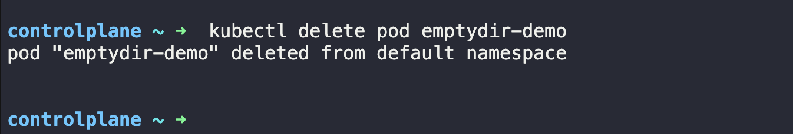
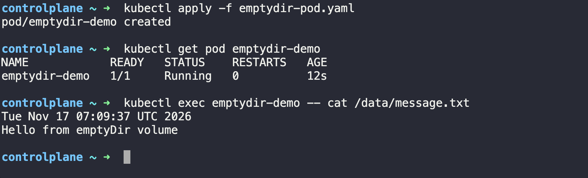
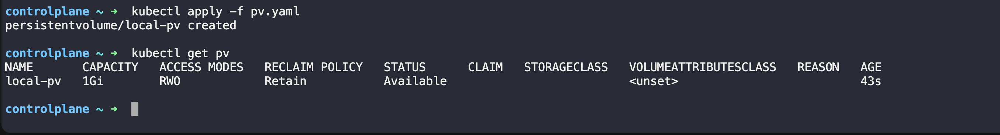
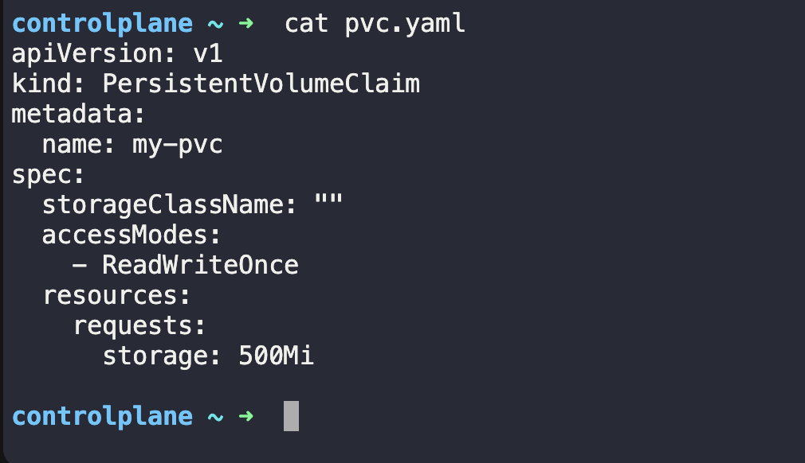
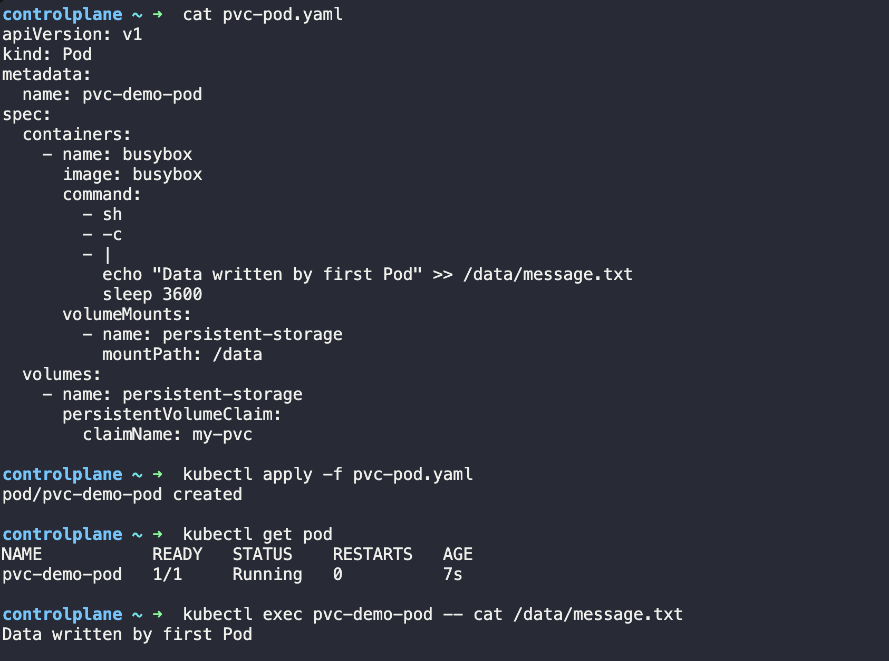
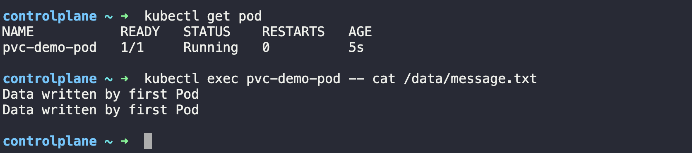
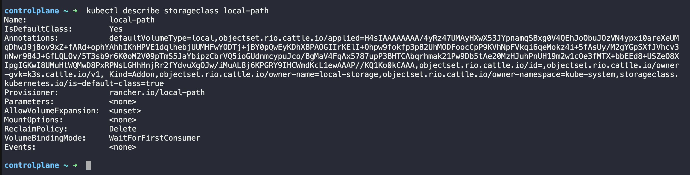
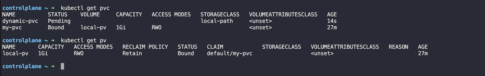
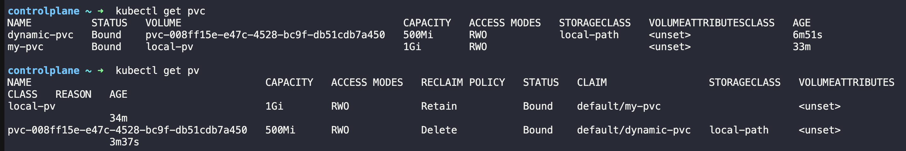
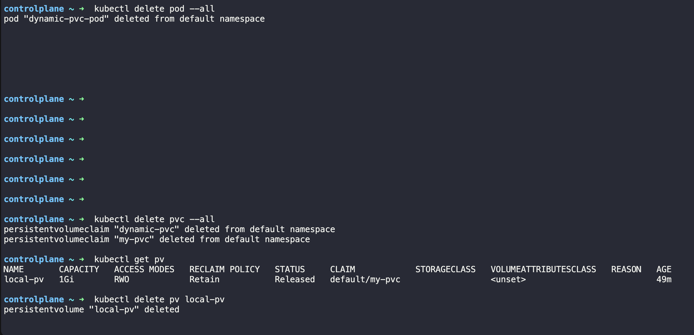

# TASKS 

Containers are ephemeral — when a Pod dies, everything inside it disappears. That is a serious problem for databases and anything that needs to survive a restart. Today we fix this with Persistent Volumes and Persistent Volume Claims.

# Task 1: See the Problem — Data Lost on Pod Deletion

This task demonstrates an important Kubernetes storage concept: `emptyDir` is temporary **storage tied to a Pod's lifecycle**.

If the Pod is deleted, its `emptyDir` data is deleted too. A newly created Pod gets a fresh, empty volume.

### Step 1: Create the Pod manifest
Create a file named `emptydir-pod.yaml`:

```YAML 
apiVersion: v1
kind: Pod
metadata:
  name: emptydir-demo
spec:
  containers:
    - name: busybox
      image: busybox
      command:
        - sh
        - -c
        - |
          date > /data/message.txt
          echo "Hello from emptyDir volume" >> /data/message.txt
          sleep 3600
      volumeMounts:
        - name: temporary-storage
          mountPath: /data
  volumes:
    - name: temporary-storage
      emptyDir: {}
```


#### Understand the important parts

1. Define the emptyDir volume
```YAML 
volumes: 
  - name: temporary-storage
    emptyDir: {}
```
The container can now access the volume at `/data.`


3. Write a timestamped message
```bash 
date > /data/message.txt
```

This records the current date and time in the file.
sleep 3600 keeps the container running so we can inspect the file.

### Step 2: Inspect your manifest
RUN: 
```bash 
cat emptydir-pod.yaml
```

OUTPUT:


### Step 2: Create the Pod
Run:

```bash 
kubectl apply -f emptydir-pod.yaml
```
check it's status 
```bash 
kubectl get pod emptydir-demo
```
wait until it shows `Running`

### Step 3: Verify the data
Run:

```bash 
kubectl exec emptydir-demo -- cat /data/message.txt
```
OUTPUT:


 **Important**: Save the timestamp from your actual output. We'll compare it after deleting and recreating the Pod.

### Step 4: Delete the Pod
Run:
```bash 
kubectl delete pod emptydir-demo
```
OUTPUT:


What happens now?
- Kubernetes deletes the Pod and its associated `emptyDir ` volume. The data stored in that volume is lost.

### Step 5: Recreate the Pod

Run:
```bash 
kubectl apply -f emptydir-pod.yaml
```

Wait until it is running:
```bash 
kubectl get pod emptydir-demo
```
### Step 6: Check the file again
```bash 
kubectl exec emptydir-demo -- cat /data/message.txt
```
OUTPUT:


we can see a new timestamp and the message again.

#### Verify: Is the timestamp the same or different after recreation?

Different. ✅
- Before deletion: `06:58:32`
- After recreation: `07:09:37`

The old data was lost, and the new Pod created a fresh emptyDir volume with a new timestamp.

#### Q: What is emptyDir in Kubernetes?

`emptyDir` is a temporary volume created when a Pod is assigned to a node. It is shared between containers in that Pod if mounted by multiple containers. Its data survives individual container restarts but is deleted when the Pod is removed.

Remember:
- Container restart →` emptyDir` data survives.
- Pod deletion → `emptyDir` data is lost.
- New Pod with the same name → gets a fresh `emptyDir`

# Task 2: Create a PersistentVolume (Static Provisioning)
In this Task we are moving from temporary storage (`emptyDir`) to **PersistentVolumes (PV)**.

In this task, we'll create a PV manually. This is called **Static Provisioning** because an administrator creates the storage resource instead of Kubernetes creating it dynamically.

### Step 1: Create the PV manifest

Create a file named `pv.yaml`:
```YAML 
apiVersion: v1
kind: PersistentVolume
metadata:
  name: local-pv
spec:
  capacity:
    storage: 1Gi
  accessModes:
    - ReadWriteOnce
  persistentVolumeReclaimPolicy: Retain
  hostPath:
    path: /tmp/k8s-pv-data
    type: DirectoryOrCreate
```

#### Understand the configuration
```
Field	                                  Meaning
kind: PersistentVolume	         Creates a PV resource
storage: 1Gi	                   Storage capacity is 1 GiB
ReadWriteOnce	                   Read-write access from a single node
Retain	                         Keeps the underlying storage after PVC release
hostPath	                       Uses a directory on the Kubernetes node
DirectoryOrCreate                Creates the directory if it doesn't exist
```

**Important**: hostPath is suitable for this learning exercise, but generally not recommended for production storage.

#### Access modes to know:

- `ReadWriteOnce (RWO)` — read-write by a single node
- `ReadOnlyMany (ROX)` — read-only by many nodes
- `ReadWriteMany (RWX)` — read-write by many nodes


### Step 2: Inspect your manifest
Run:
```bash 
cat pv.yaml
```
OUTPUT:


### Step 3: Apply the PV

Run:
```bash 
kubectl apply -f pv.yaml
```
### Step 4: Check PV status
```bash 
kubectl get pv
```

OUTPUT:


Why Available?

- Because we created the `PersistentVolume`, but no `PersistentVolumeClaim `(PVC) has requested or bound to it yet.

#### Q-> What is the STATUS of the PV?

The PV status is `Available`.

It means:
- Kubernetes has successfully created the PersistentVolume.
- The PV has 1 GiB capacity.
- It supports `ReadWriteOnce`.
- It is not yet bound to any `PersistentVolumeClaim (PVC)`.

### One important concept

Remember the lifecycle:
`Available` → `Bound` → `Released` (after PVC deletion, depending on reclaim policy).

our Retain policy means Kubernetes preserves the underlying storage when its PVC is deleted. It does not automatically delete the stored data.

**NOTE -> A PersistentVolume is a storage resource in the cluster. It exists independently of a Pod, so its data can survive Pod deletion, unlike `emptyDir`.**

# Task 3: Create a PersistentVolumeClaim

our PV `local-pv` is currently `Available` with `1Gi` capacity. Now we'll request `500Mi` and let Kubernetes match the PVC to that PV.


### Step 1: Create the PVC manifest
Create a file:
```bash 
vi pvc.yaml 
```

Add this YAML:
```YAML 
apiVersion: v1
kind: PersistentVolumeClaim
metadata:
  name: my-pvc
spec:
  accessModes:
    - ReadWriteOnce
  resources:
    requests:
      storage: 500Mi
```

#### Understanding the important fields:
- `kind: PersistentVolumeClaim` → request for storage.

- `accessModes: ReadWriteOnce` → request storage that can be mounted read-write by one node

- `storage: 500Mi` → the amount of storage requested.

- Kubernetes will look for a suitable PV that meets the requirements.

### Step 2: Apply it
```bash 
kubectl apply -f pvc.yaml
```

### Step 3: Verify both resources

```bash 
kubectl get pvc
kubectl get pv
```
we should expect something similar:

OUTPUT:


our YAML is correct, but the PVC is `Pending` instead of `Bound`. This is a very useful real-world Kubernetes troubleshooting scenario.

Why isn't the PVC binding?

Look at our output:
```
Resource:                  StorageClass

`local-pv`     ->.     <unset> (no StorageClass)
 
`my-pvc`.      ->.            `local-path`


```

our PV is a statically created PV with no StorageClass, but Kubernetes automatically assigned the default StorageClass `local-path` to our PVC.

Therefore, they aren't matching as expected.

- PV: no StorageClass


- PVC: `local-path`


- Result: `Pending`

### Step 1: Update your PVC manifest

Edit it:

```bash 
vi pvc.yaml
```

Add `storageClassName: "" ` under spec, like this:

The empty string explicitly tells Kubernetes: don't use the default StorageClass; match with a PV that has no StorageClass.

OUTPUT:


### Step 2: Delete the pending PVC and recreate it

Because the PVC was already created with its StorageClass assigned, delete and recreate it:

```bash 
kubectl delete pvc my-pvc
# Then:
kubectl apply -f pvc.yaml

```
### Step 3: Verify

```bash 
kubectl get pvc
kubectl get pv
```
OUTPUT:


#### Verify: What does the VOLUME column in kubectl get pvc show?

The `VOLUME` column in the PVC output shows:
```
local-pv
```
This means your PVC `my-pvc` has successfully claimed the PV `local-pv`.


**Important:** PVCs don't necessarily need an exact capacity match. The PV can be larger than the requested storage.


# Task 4: Use the PVC in a Pod — Data That Survives

Repeat the Task-02 and Task-03 if you are preacticing in LAB enviromment 

Now our PVC `my-pvc` is already Bound to `local-pv`. Now we'll use it inside a Pod.

### Step 1: Create the Pod manifest
Create a file:
```bash 
vi pvc-pod.yaml 
```
Add this YAML:
```YAML 
apiVersion: v1
kind: Pod
metadata:
  name: pvc-demo-pod
spec:
  containers:
    - name: busybox
      image: busybox
      command:
        - sh
        - -c
        - |
          echo "Data written by first Pod" >> /data/message.txt
          sleep 3600
      volumeMounts:
        - name: persistent-storage
          mountPath: /data
  volumes:
    - name: persistent-storage
      persistentVolumeClaim:
        claimName: my-pvc
```

### Step 2: Create the first Pod
```bash 
kubectl apply -f pvc-pod.yaml
kubectl get pod pvc-demo-pod
```
Wait until its status is `Running`.

Check the file:
```bash 
kubectl exec pvc-demo-pod -- cat /data/message.txt
```

OUTPUT:


### Step 3: Delete the first Pod
```bash 
kubectl delete pod pvc-demo-pod
```
Wait for it to be deleted.

### Step 4: Recreate the Pod

```bash 
kubectl apply -f pvc-pod.yaml
kubectl get pod pvc-demo-pod
```
Wait until it is Running.

### Step 5: Check the file again
```bash 
kubectl exec pvc-demo-pod -- cat /data/message.txt
```
OUTPUT:


Why two lines? The first Pod wrote one line. The second Pod mounted the same PVC and appended another line to the existing file.

`emptyDir` -> Data is lost when the Pod is removed

PVC-backed volume -> Data persists independently of the Pod

#### Verify: Does the file contain data from both the first and second Pod?

Yes! Both lines are present in `/data/message.txt`:

```
Data written by first Pod
Data written by first Pod
```
- First line: written by the first Pod.
- Second line: appended by the second Pod after recreating it.

This confirms that the PVC preserved the data across Pod deletion and recreation.

A PersistentVolumeClaim provides persistent storage to a Pod. Unlike emptyDir, data stored on a PVC-backed volume survives Pod deletion and can be accessed by a newly created Pod that mounts the same PVC.

One important distinction: PVC-backed data survives Pod deletion, but not necessarily deletion or reset of the underlying storage.

# Task 5: StorageClasses and Dynamic Provisioning.

From our earlier PVC output, Kubernetes automatically assigned `local-path` as the StorageClass. This suggests that `local-path` is your cluster's default StorageClass.

### Step 1: List StorageClasses
Run:

```bash 
kubectl get storageclass
```
OUTPUT:


- The `(default)` label identifies the default StorageClass.


### Step 2: Describe the StorageClass
Run:
```bash 
kubectl describe storageclass
```
Or describe the specific class:

```bash 
kubectl describe storageclass local-path
```
OUTPUT:



Pay attention to these three fields:

- `Provisioner` ->   Component responsible for creating storage , Here in output it is  `Provisioner:           rancher.io/local-path` , The local-path provisioner dynamically creates storage using local node directories.


- `ReclaimPolicy`	  -> What happens to the PV when its PVC is deleted , Here it is  `ReclaimPolicy:         Delete` , When the PVC is deleted, the dynamically provisioned PV is deleted, and its associated storage data is generally removed by the provisioner.


- `VolumeBindingMode` ->    	When Kubernetes binds the PVC to a PV , here `VolumeBindingMode:     WaitForFirstConsumer`This is particularly important. Kubernetes waits until a Pod using the PVC is scheduled before provisioning and binding the volume.  Why? Because it helps select storage on a node suitable for the Pod.

### Step 3: Understand dynamic provisioning

- Without dynamic provisioning -> Developer creates PVC → Kubernetes searches for an existing suitable PV.

- With dynamic provisioning -> Developer creates PVC → StorageClass provisioner automatically creates a PV → PVC gets bound.


#### Q: What is a StorageClass in Kubernetes?

A StorageClass provides a way for administrators to define different types of storage. It enables dynamic provisioning, where developers create PVCs and Kubernetes automatically provisions the required PV through the configured provisioner.

# Task 6: Dynamic Provisioning.

In Task 5, we confirmed that our cluster's default StorageClass is local-path, not standard.

We'll use `local-path` for this exercise.

### Step 1: Create a dynamic PVC
Create a file:

```bash 
vi dynamic-pvc.yaml
```

Add:
```YAML
apiVersion: v1
kind: PersistentVolumeClaim
metadata:
  name: dynamic-pvc
spec:
  storageClassName: local-path
  accessModes:
    - ReadWriteOnce
  resources:
    requests:
      storage: 500Mi
```
Apply it:

```bash 
kubectl apply -f dynamic-pvc.yaml
```
Check:
```bash 
kubectl get pvc
kubectl get pv
```
OutPut:


### Step 2: Create a Pod using the dynamic PVC

Create:
```bash 
vi dynamic-pvc-pod.yaml
```

Add:
```YAML 
apiVersion: v1
kind: Pod
metadata:
  name: dynamic-pvc-pod
spec:
  containers:
    - name: busybox
      image: busybox
      command:
        - sh
        - -c
        - |
          echo "Data created using dynamic provisioning" > /data/message.txt
          sleep 3600
      volumeMounts:
        - name: storage
          mountPath: /data
  volumes:
    - name: storage
      persistentVolumeClaim:
        claimName: dynamic-pvc
  
  ```
Apply:

```bash 
kubectl apply -f dynamic-pvc-pod.yaml
```
Wait for the Pod:
```bash 
kubectl get pod dynamic-pvc-pod
```

### Step 3: Verify the data
```bash 
kubectl exec dynamic-pvc-pod -- cat /data/message.txt
```
### Step 4: Check your PVs
Run:

```bash 
kubectl get pv
kubectl get pvc
```
OUTPUT:


#### Understand the difference
- Static provisioning -> Administrator manually creates PV -> `local-pv`

- Dynamic provisioning -> StorageClass provisioner automatically creates PV -> PV created for `dynamic-pvc`

### Verify: How many PVs exist now? Which was manual, which was dynamic?
There are 2 Persistent Volumes (PVs) in your cluster now. Both are in the Bound state.

| PV Name | Type | Capacity | StorageClass | Reclaim Policy | PVC |
|---|---|---|---|---|---|
| local-pv | Manual (Static) | 1Gi | None | Retain | my-pvc |
| pvc-008ff15e-e47c-4528-bc9f-db51cdb7a450 | Dynamic | 500Mi | local-path | Delete | dynamic-pvc |


How to identify them
1. Manual (Static) PV — `local-pv`
- we manually created it using `pv.yaml`.
- It uses `hostPath: /tmp/k8s-pv-data`.
- It has a `Retain` reclaim policy.


2. Dynamic PV — `pvc-008ff15e-e47c-4528-bc9f-db51cdb7a450`
- Kubernetes automatically created it through the local-path StorageClass.
- It was created when `dynamic-pvc` was used by a Pod.
- It has a `Delete` reclaim policy.

Interview-ready answer:

I currently have two PVs. One is a statically provisioned PV that I manually created, and the other was dynamically provisioned by the `local-path` StorageClass when a PVC requested storage. Both PVs are successfully bound to their respective PVCs.


# Task 7: Clean Up — What you should observe

Based on our previous PV configuration, here is the expected result.

1. Delete all Pods first
```bash 
kubectl delete pod --all
```

2. Delete all PVCs

```bash 
kubectl delete pvc --all
```

3. Check the PV status
```bash 
kubectl get pv
```

OUTPUT:


Expected behavior:

| PV | Reclaim Policy | Expected Result |
|---|---|---|
| pvc-008ff15e-e47c-4528-bc9f-db51cdb7a450 | Delete | Automatically deleted |
| local-pv | Retain | Remains in Released state |


Why?

- **Dynamic PV**: Its reclaim policy is Delete. When its PVC is deleted, Kubernetes and the storage provisioner delete the PV and, depending on the provisioner, the underlying storage.

- **Manual PV**: Its reclaim policy is Retain. When its PVC is deleted, the PV and underlying data are preserved, and its status becomes Released. It is not automatically made available for another claim.

4. Delete the remaining PV manually

```bash 
kubectl delete pv local-pv
```

Verify — interview-ready answer

- The dynamically provisioned PV was automatically deleted because its reclaim policy was `Delete`. The manually created PV was retained in the `Released` state because its reclaim policy was `Retain`. I then deleted the retained PV manually.
