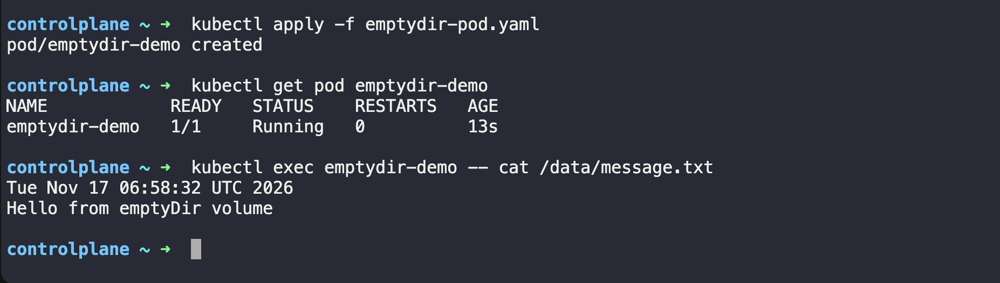

# TASKS 

Containers are ephemeral — when a Pod dies, everything inside it disappears. That is a serious problem for databases and anything that needs to survive a restart. Today we fix this with Persistent Volumes and Persistent Volume Claims.

# Task 1: See the Problem — Data Lost on Pod Deletion

This task demonstrates an important Kubernetes storage concept: `emptyDir` is temporary **storage tied to a Pod's lifecycle**.

If the Pod is deleted, its `emptyDir` data is deleted too. A newly created Pod gets a fresh, empty volume.

### Step 1: Create the Pod manifest
Create a file named `emptydir-pod.yaml`:

```YAML 
apiVersion: v1
kind: Pod
metadata:
  name: emptydir-demo
spec:
  containers:
    - name: busybox
      image: busybox
      command:
        - sh
        - -c
        - |
          date > /data/message.txt
          echo "Hello from emptyDir volume" >> /data/message.txt
          sleep 3600
      volumeMounts:
        - name: temporary-storage
          mountPath: /data
  volumes:
    - name: temporary-storage
      emptyDir: {}
```


#### Understand the important parts

1. Define the emptyDir volume
```YAML 
volumes: 
  - name: temporary-storage
    emptyDir: {}
```
The container can now access the volume at `/data.`


3. Write a timestamped message
```bash 
date > /data/message.txt
```

This records the current date and time in the file.
sleep 3600 keeps the container running so we can inspect the file.

### Step 2: Inspect your manifest
RUN: 
```bash 
cat emptydir-pod.yaml
```

OUTPUT:


### Step 2: Create the Pod
Run:

```bash 
kubectl apply -f emptydir-pod.yaml
```
check it's status 
```bash 
kubectl get pod emptydir-demo
```
wait until it shows `Running`

### Step 3: Verify the data
Run:

```bash 
kubectl exec emptydir-demo -- cat /data/message.txt
```
OUTPUT:


 **Important**: Save the timestamp from your actual output. We'll compare it after deleting and recreating the Pod.

### Step 4: Delete the Pod
Run:
```bash 
kubectl delete pod emptydir-demo
```
OUTPUT:


What happens now?
- Kubernetes deletes the Pod and its associated `emptyDir ` volume. The data stored in that volume is lost.

### Step 5: Recreate the Pod

Run:
```bash 
kubectl apply -f emptydir-pod.yaml
```

Wait until it is running:
```bash 
kubectl get pod emptydir-demo
```
### Step 6: Check the file again
```bash 
kubectl exec emptydir-demo -- cat /data/message.txt
```
OUTPUT:


we can see a new timestamp and the message again.

#### Verify: Is the timestamp the same or different after recreation?

Different. ✅
- Before deletion: `06:58:32`
- After recreation: `07:09:37`

The old data was lost, and the new Pod created a fresh emptyDir volume with a new timestamp.

#### Q: What is emptyDir in Kubernetes?

`emptyDir` is a temporary volume created when a Pod is assigned to a node. It is shared between containers in that Pod if mounted by multiple containers. Its data survives individual container restarts but is deleted when the Pod is removed.

Remember:
- Container restart →` emptyDir` data survives.
- Pod deletion → `emptyDir` data is lost.
- New Pod with the same name → gets a fresh `emptyDir`

