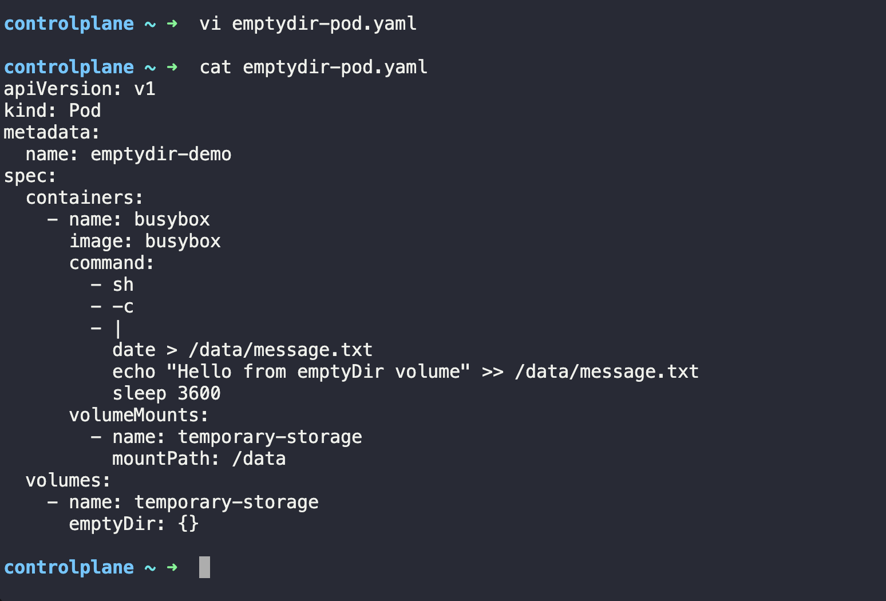
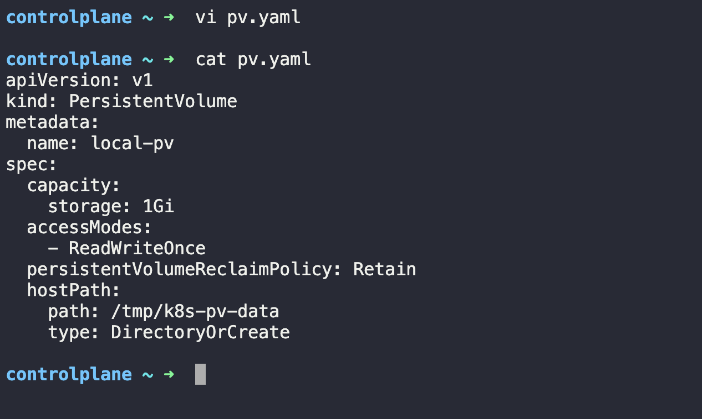
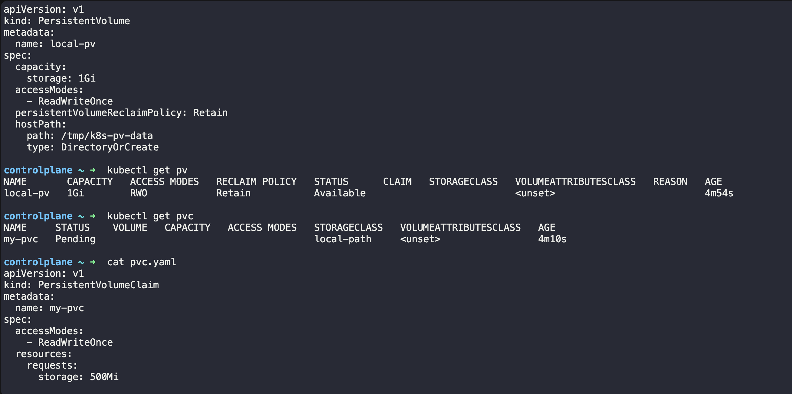
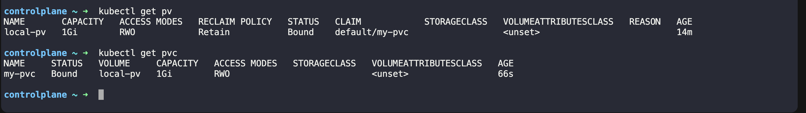

# TASKS 

Containers are ephemeral — when a Pod dies, everything inside it disappears. That is a serious problem for databases and anything that needs to survive a restart. Today we fix this with Persistent Volumes and Persistent Volume Claims.

# Task 1: See the Problem — Data Lost on Pod Deletion

This task demonstrates an important Kubernetes storage concept: `emptyDir` is temporary **storage tied to a Pod's lifecycle**.

If the Pod is deleted, its `emptyDir` data is deleted too. A newly created Pod gets a fresh, empty volume.

### Step 1: Create the Pod manifest
Create a file named `emptydir-pod.yaml`:

```YAML 
apiVersion: v1
kind: Pod
metadata:
  name: emptydir-demo
spec:
  containers:
    - name: busybox
      image: busybox
      command:
        - sh
        - -c
        - |
          date > /data/message.txt
          echo "Hello from emptyDir volume" >> /data/message.txt
          sleep 3600
      volumeMounts:
        - name: temporary-storage
          mountPath: /data
  volumes:
    - name: temporary-storage
      emptyDir: {}
```


#### Understand the important parts

1. Define the emptyDir volume
```YAML 
volumes: 
  - name: temporary-storage
    emptyDir: {}
```
The container can now access the volume at `/data.`


3. Write a timestamped message
```bash 
date > /data/message.txt
```

This records the current date and time in the file.
sleep 3600 keeps the container running so we can inspect the file.

### Step 2: Inspect your manifest
RUN: 
```bash 
cat emptydir-pod.yaml
```

OUTPUT:


### Step 2: Create the Pod
Run:

```bash 
kubectl apply -f emptydir-pod.yaml
```
check it's status 
```bash 
kubectl get pod emptydir-demo
```
wait until it shows `Running`

### Step 3: Verify the data
Run:

```bash 
kubectl exec emptydir-demo -- cat /data/message.txt
```
OUTPUT:


 **Important**: Save the timestamp from your actual output. We'll compare it after deleting and recreating the Pod.

### Step 4: Delete the Pod
Run:
```bash 
kubectl delete pod emptydir-demo
```
OUTPUT:


What happens now?
- Kubernetes deletes the Pod and its associated `emptyDir ` volume. The data stored in that volume is lost.

### Step 5: Recreate the Pod

Run:
```bash 
kubectl apply -f emptydir-pod.yaml
```

Wait until it is running:
```bash 
kubectl get pod emptydir-demo
```
### Step 6: Check the file again
```bash 
kubectl exec emptydir-demo -- cat /data/message.txt
```
OUTPUT:


we can see a new timestamp and the message again.

#### Verify: Is the timestamp the same or different after recreation?

Different. ✅
- Before deletion: `06:58:32`
- After recreation: `07:09:37`

The old data was lost, and the new Pod created a fresh emptyDir volume with a new timestamp.

#### Q: What is emptyDir in Kubernetes?

`emptyDir` is a temporary volume created when a Pod is assigned to a node. It is shared between containers in that Pod if mounted by multiple containers. Its data survives individual container restarts but is deleted when the Pod is removed.

Remember:
- Container restart →` emptyDir` data survives.
- Pod deletion → `emptyDir` data is lost.
- New Pod with the same name → gets a fresh `emptyDir`

# Task 2: Create a PersistentVolume (Static Provisioning)
In this Task we are moving from temporary storage (`emptyDir`) to **PersistentVolumes (PV)**.

In this task, we'll create a PV manually. This is called **Static Provisioning** because an administrator creates the storage resource instead of Kubernetes creating it dynamically.

### Step 1: Create the PV manifest

Create a file named `pv.yaml`:
```YAML 
apiVersion: v1
kind: PersistentVolume
metadata:
  name: local-pv
spec:
  capacity:
    storage: 1Gi
  accessModes:
    - ReadWriteOnce
  persistentVolumeReclaimPolicy: Retain
  hostPath:
    path: /tmp/k8s-pv-data
    type: DirectoryOrCreate
```

#### Understand the configuration
```
Field	                                  Meaning
kind: PersistentVolume	         Creates a PV resource
storage: 1Gi	                   Storage capacity is 1 GiB
ReadWriteOnce	                   Read-write access from a single node
Retain	                         Keeps the underlying storage after PVC release
hostPath	                       Uses a directory on the Kubernetes node
DirectoryOrCreate                Creates the directory if it doesn't exist
```

**Important**: hostPath is suitable for this learning exercise, but generally not recommended for production storage.

#### Access modes to know:

- `ReadWriteOnce (RWO)` — read-write by a single node
- `ReadOnlyMany (ROX)` — read-only by many nodes
- `ReadWriteMany (RWX)` — read-write by many nodes


### Step 2: Inspect your manifest
Run:
```bash 
cat pv.yaml
```
OUTPUT:


### Step 3: Apply the PV

Run:
```bash 
kubectl apply -f pv.yaml
```
### Step 4: Check PV status
```bash 
kubectl get pv
```

OUTPUT:


Why Available?

- Because we created the `PersistentVolume`, but no `PersistentVolumeClaim `(PVC) has requested or bound to it yet.

#### Q-> What is the STATUS of the PV?

The PV status is `Available`.

It means:
- Kubernetes has successfully created the PersistentVolume.
- The PV has 1 GiB capacity.
- It supports `ReadWriteOnce`.
- It is not yet bound to any `PersistentVolumeClaim (PVC)`.

### One important concept

Remember the lifecycle:
`Available` → `Bound` → `Released` (after PVC deletion, depending on reclaim policy).

our Retain policy means Kubernetes preserves the underlying storage when its PVC is deleted. It does not automatically delete the stored data.

**NOTE -> A PersistentVolume is a storage resource in the cluster. It exists independently of a Pod, so its data can survive Pod deletion, unlike `emptyDir`.**

# Task 3: Create a PersistentVolumeClaim

our PV `local-pv` is currently `Available` with `1Gi` capacity. Now we'll request `500Mi` and let Kubernetes match the PVC to that PV.


### Step 1: Create the PVC manifest
Create a file:
```bash 
vi pvc.yaml 
```

Add this YAML:
```YAML 
apiVersion: v1
kind: PersistentVolumeClaim
metadata:
  name: my-pvc
spec:
  accessModes:
    - ReadWriteOnce
  resources:
    requests:
      storage: 500Mi
```

#### Understanding the important fields:
- `kind: PersistentVolumeClaim` → request for storage.

- `accessModes: ReadWriteOnce` → request storage that can be mounted read-write by one node

- `storage: 500Mi` → the amount of storage requested.

- Kubernetes will look for a suitable PV that meets the requirements.

### Step 2: Apply it
```bash 
kubectl apply -f pvc.yaml
```

### Step 3: Verify both resources

```bash 
kubectl get pvc
kubectl get pv
```
we should expect something similar:

OUTPUT:


our YAML is correct, but the PVC is `Pending` instead of `Bound`. This is a very useful real-world Kubernetes troubleshooting scenario.

Why isn't the PVC binding?

Look at our output:
```
Resource:                  StorageClass

`local-pv`     ->.     <unset> (no StorageClass)
 
`my-pvc`.      ->.            `local-path`


```

our PV is a statically created PV with no StorageClass, but Kubernetes automatically assigned the default StorageClass `local-path` to our PVC.

Therefore, they aren't matching as expected.

- PV: no StorageClass


- PVC: `local-path`


- Result: `Pending`

### Step 1: Update your PVC manifest

Edit it:

```bash 
vi pvc.yaml
```

Add `storageClassName: "" ` under spec, like this:

The empty string explicitly tells Kubernetes: don't use the default StorageClass; match with a PV that has no StorageClass.

OUTPUT:


### Step 2: Delete the pending PVC and recreate it

Because the PVC was already created with its StorageClass assigned, delete and recreate it:

```bash 
kubectl delete pvc my-pvc
# Then:
kubectl apply -f pvc.yaml

```
### Step 3: Verify

```bash 
kubectl get pvc
kubectl get pv
```
OUTPUT:


#### Verify: What does the VOLUME column in kubectl get pvc show?

The `VOLUME` column in the PVC output shows:
```
local-pv
```
This means your PVC `my-pvc` has successfully claimed the PV `local-pv`.


**Important:** PVCs don't necessarily need an exact capacity match. The PV can be larger than the requested storage.


