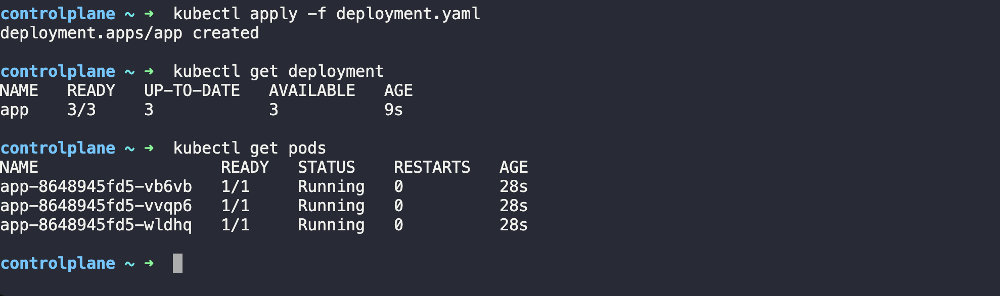
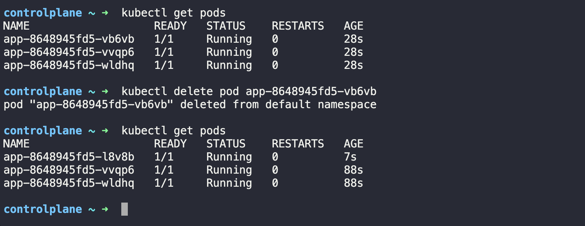
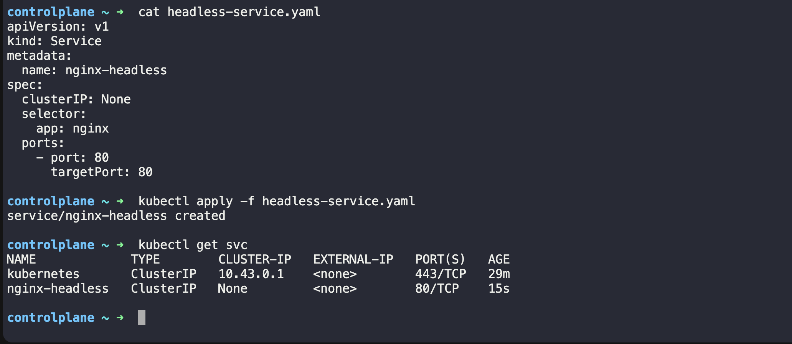
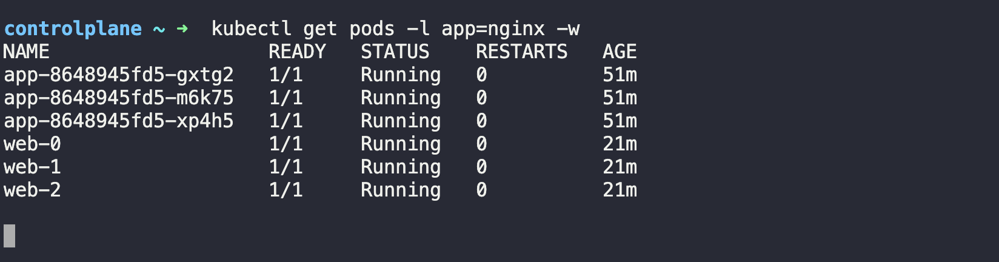
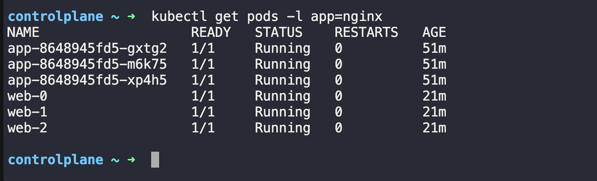
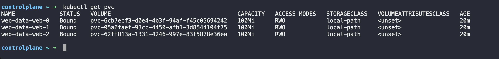

# Kubernetes StatefulSets

## Task
Deployments work great for stateless apps, but what about databases? You need stable pod names, ordered startup, and persistent storage per replica. Today you learn StatefulSets — the workload designed for stateful applications like MySQL, PostgreSQL, and Kafka.

--

# Task 1: Understand the Problem — Deployment

This task is designed to show  why **Kubernetes Deployments are not always suitable for stateful applications like databases**.

### Step 1: Create a Deployment with 3 Nginx replicas

Create a file:
```bash 
vi deployment.yaml 
```
Add the following:
```YAML 

apiVersion: apps/v1
kind: Deployment
metadata:
  name: app
spec:
  replicas: 3
  selector:
    matchLabels:
      app: nginx
  template:
    metadata:
      labels:
        app: nginx
    spec:
      containers:
        - name: nginx
          image: nginx
          ports:
            - containerPort: 80

```

Save the file and apply it:

```bash
kubectl apply --f deployment.yaml
```

### Step 2: Check the Pod names
```bash 
kubectl get pods
```
OUTPUT:


### Step 3: Delete one Pod

Pick one Pod and delete it:
```bash 
kubectl delete pod <pod name> 

# for example 
kubectl delete pod app-7d9f8c6b4d-x2abc

```

Now check again:
```bash 
kubectl get pods 
```
OUTPUT:


The Deployment's ReplicaSet controller will notice that only two replicas remain and create a replacement Pod to bring the replica count back to 3.

However, the replacement will have a **different Pod name**.

### Why is this a problem for databases?
Imagine a database cluster with 3 database nodes:

- Database Node 0
- Database Node 1
- Database Node 2

Each node might have its own responsibilities, data, replication state, or cluster identity.

With a Deployment, if a Pod is deleted:
- Kubernetes creates a replacement with a new random name.
- Pod identity is not guaranteed to remain the same.
- It becomes harder for cluster members to identify one another consistently by Pod identity.
- Applications that rely on stable node identities can face complications.


For example, a distributed database may expect its nodes to be consistently identifiable as `db-0`, `db-1`, and  `db-2`.

That's where a StatefulSet comes in: it provides stable Pod identities, such as `db-0`, `db-1`, and `db-2`, even when those Pods are recreated.

#### Verify: Why would random pod names be a problem for a database cluster?

If Pods in a database cluster keep getting recreated with different names, it becomes difficult to maintain a stable identity for each database node. We may have difficulty associating a specific node with its role, replication state, and persistent data. In distributed databases, each node may have its own identity and responsibilities, so stable identity is important for cluster coordination, replication, and recovery.

Interview-ready answer
- In a Deployment, Pods are replaceable and their names are not stable. For stateless applications, this is perfectly fine, but for a database cluster, each node may have its own identity, replication role, and persistent data. If a Pod is recreated with a different identity, it can complicate node identification, replication, and data association. StatefulSets solve this by providing stable Pod identities and dedicated persistent storage for each replica.

The key concept to remember
- **Deployment:** Pods are interchangeable.
- **StatefulSet:** Pods have individual identities.


For example:

```
StatefulSet Pod               Identity


db-0                ->     Database node 0

db-1                ->     Database node 1

db-2                ->     Database node 2

```

If `db-1` crashes, Kubernetes recreates `db-1`, not some entirely new identity like `db-x7p9q`.

# Task 2: Create a Headless Service
Repeate The Task-01 Again and come to this Task afterwards 

In this Task we are going to create a **Headless Service**, which is important for StatefulSets because it allows each Pod to be individually discoverable through DNS

### Step 1: Create the manifest
Create a file:
```bash 
vi headless-service.yaml
```
Add the following: 
```YAML 

apiVersion: v1
kind: Service
metadata:
  name: nginx-headless
spec:
  clusterIP: None
  selector:
    app: nginx
  ports:
    - port: 80
      targetPort: 80
```
### Step 2: Apply it
```bash 
kubectl apply -f headless-service.yaml
```

### Step 3: Verify
```bash 
kubectl get svc 
```
OUTPUT:


- A Headless Service creates individual DNS entries for each pod instead of load-balancing to one IP. StatefulSets require this.

####  Why `clusterIP: None` ?

Normally, a Service gets a virtual IP (`ClusterIP`), and traffic to that IP is load-balanced across matching Pods.

A Headless Service skips that virtual IP. Instead, Kubernetes DNS can return the individual Pod IP addresses, allowing clients to discover and communicate with specific Pods.

For StatefulSets, this enables stable DNS identities such as:
`nginx-0.nginx-headless.default.svc.cluster.local`

#### Verify: What does the `CLUSTER-IP` column show?

`Verified: CLUSTER-IP = None`

What does this mean?
- Normally, a Kubernetes Service gets a ClusterIP, which acts as a virtual IP and load-balances traffic across matching Pods.

our Headless Service
```YAML 
clusterIP: None
```
does not create a virtual IP for load balancing. Instead, Kubernetes DNS can return the IP addresses of the individual Pods that match the Service selector.

our selector is also correct:
```YAML 
selector:
  app: nginx
```
- This means the Service will discover Pods carrying the label `app: nginx`.

# Task 3: Create a StatefulSet

This is the most important task so far because now we'll see how a StatefulSet manages **stable Pod identity** and **dedicated storage for each replica**.

Unlike a Deployment, a StatefulSet creates Pods in an ordered sequence by default:

`web-0 → web-1 → web-2`

It waits for the preceding Pod to become Ready before creating the next one.

### Step 1: Create the StatefulSet YAML
Create the manifest:
```bash 
vi statefulset.yaml
```

ADD:
```YAML 
apiVersion: apps/v1
kind: StatefulSet
metadata:
  name: web
spec:
  serviceName: nginx-headless
  replicas: 3
  selector:
    matchLabels:
      app: nginx
  template:
    metadata:
      labels:
        app: nginx
    spec:
      containers:
        - name: nginx
          image: nginx
          ports:
            - containerPort: 80
          volumeMounts:
            - name: web-data
              mountPath: /usr/share/nginx/html
  volumeClaimTemplates:
    - metadata:
        name: web-data
      spec:
        accessModes:
          - ReadWriteOnce
        resources:
          requests:
            storage: 100Mi
```

### Step 2: Understand the important parts

`serviceName: nginx-headless` ->     Connects the StatefulSet to your Headless Service

`replicas: 3` ->   Creates three Pods

`matchLabels: app: nginx`   -> Matches the Pod labels

`volumeClaimTemplates`     -> Automatically creates a separate PVC for each Pod

`name: web-data`           -> PVC name prefix

`storage: 100Mi`          ->    Each Pod requests 100Mi of storage

`ReadWriteOnce`           ->    Volume can be mounted read-write from one node at a time


The key part is `volumeClaimTemplates`. You don't manually create three PVCs. Kubernetes automatically creates one PVC per StatefulSet Pod.

### Step 3: Apply the StatefulSet

```bash 
kubectl apply -f statefulset.yaml
```
Watch the Pods being created in order:

```bash 
kubectl get pods -l app=nginx -w
```
OUTPUT:


### Step 4: Verify Pod names

```bash
kubectl get pods -l app=nginx
```
OUTPUT:



- Unlike Deployment Pods, these names are predictable and stable.


### Step 5: Verify PVCs
```bash 
kubectl get pvc
```
OUTPUT:


- All three PVCs are Bound, meaning Kubernetes successfully matched each storage claim to a Persistent Volume.


The naming pattern is:

`<volumeClaimTemplate-name>-<StatefulSet-pod-name>`

So:
- `web-data + web-0 → web-data-web-0`
- `web-data + web-1 → web-data-web-1`
- `web-data + web-2 → web-data-web-2`


If `web-1` is deleted, Kubernetes recreates `web-1` and reconnects it to its existing PVC web-data-web-1, rather than giving it a new identity and new storage claim.

That's the core reason StatefulSets are useful for databases and distributed storage systems.

    
#### Verify: What are the exact pod names and PVC names?


From our terminal output, the exact names are:
Pod names
```bash 
web-0
web-1
web-2
```
PVC names
```
web-data-web-0
web-data-web-1
web-data-web-2
```
Mapping
```
web-0 → web-data-web-0
web-1 → web-data-web-1
web-2 → web-data-web-2
```
All 3 PVCs are `Bound`, each requesting 100Mi of storage.

